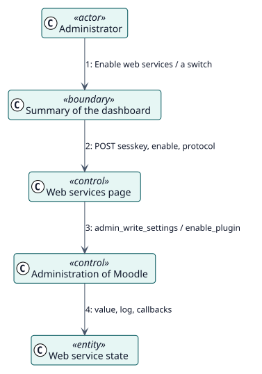

# UC-005 Turn the web services and their protocols on or off

| Overview | Requirements | Analysis | Design | Implementation | Tests |
| --- | --- | --- | --- | --- | --- |
| [Use cases](../../../requirements/use-case-overview.svg) | [Requirements](../../../requirements/use-cases/turnWebServices/README.md) | **Analysis** | [Design](../../../design/use-cases/turnWebServices/README.md) | [Implementation](../../../implementation/use-cases/turnWebServices/README.md) | [Tests](../../../implementation/use-cases/turnWebServices/README.md#tests) |

## Participating classes

| Class | Stereotype | Responsibility |
| --- | --- | --- |
| Summary of the dashboard | boundary | Shows the state and the switches, and asks before turning the web services off. |
| Web services page | control | Checks the person and writes the setting. |
| Administration of Moodle | control | Writes a setting with its log and its callbacks. |
| Web service state | entity | Whether the web services are on, and which protocols. |

## Collaboration

## Notes

The page does not write the setting by itself: it goes through the same functions as the administration of Moodle, so the log of the configuration and the callbacks are the ones of any other change.
