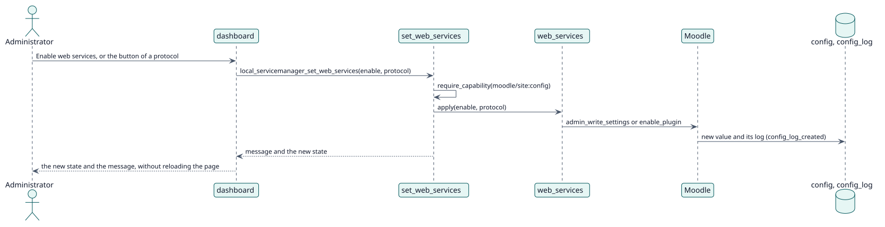

# UC-005 Turn the web services and their protocols on or off

| Overview | Requirements | Analysis | Design | Implementation | Tests |
| --- | --- | --- | --- | --- | --- |
| [Use cases](../../../requirements/use-case-overview.svg) | [Requirements](../../../requirements/use-cases/turnWebServices/README.md) | [Analysis](../../../analysis/use-cases/turnWebServices/README.md) | **Design** | [Implementation](../../../implementation/use-cases/turnWebServices/README.md) | [Tests](../../../implementation/use-cases/turnWebServices/README.md#tests) |

## Elements

| Design element | Kind | Code target |
| --- | --- | --- |
| `set_web_services` | web service (AJAX) | `classes/external/set_web_services.php` |
| `web_services::apply` | service | `classes/local/web_services.php` |
| `pages/web_services.php` | page, for a browser without script | `pages/web_services.php` |
| `admin_write_settings` | service of Moodle | `lib/adminlib.php` |
| `webservice::enable_plugin` | service of Moodle | `lib/classes/plugininfo/webservice.php` |
| `ws_status::describe` | view model | `classes/output/ws_status.php` |

## Sequence

## Contracts

| Operation | Input | Output | Errors |
| --- | --- | --- | --- |
| `local_servicemanager_set_web_services` | `enable`, optional `protocol` (and `returnurl` on Moodle 4.x) | a message and the new state (the strip drawn again on Moodle 4.x) | no capability, a protocol that is not installed |
| POST `pages/web_services.php` | `sesskey`, `enable`, optional `protocol` and `returnurl` | the page asked for, with a message | no capability, a wrong session key, a protocol that is not installed |

## Data touched

| Table or entity | Operation |
| --- | --- |
| `config` (`enablewebservices`, `webserviceprotocols`) | update |
| `config_log` | insert |
