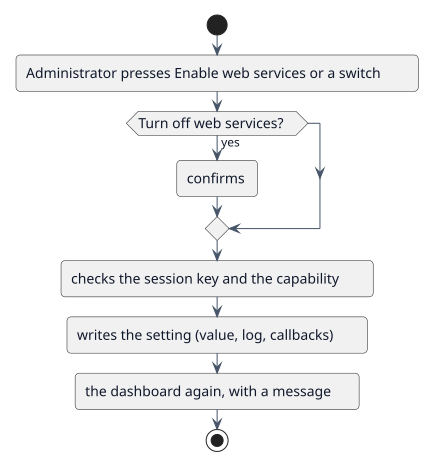

# UC-005 Turn the web services and their protocols on or off

| Overview | Requirements | Analysis | Design | Implementation | Tests |
| --- | --- | --- | --- | --- | --- |
| [Use cases](../../../requirements/use-case-overview.svg) | **Requirements** | [Analysis](../../../analysis/use-cases/turnWebServices/README.md) | [Design](../../../design/use-cases/turnWebServices/README.md) | [Implementation](../../../implementation/use-cases/turnWebServices/README.md) | [Tests](../../../implementation/use-cases/turnWebServices/README.md#tests) |

## Use-case information

| Field | Value |
| --- | --- |
| Actor | Administrator |
| Package | Administration |
| Goal | Make the web services of the site, and each protocol, answer or stop answering, without opening the administration of Moodle. |
| Type | Primary, essential |
| Level | User goal |
| Requirement | RF-008 |
| Domain entities | WebServiceState |

## Context

A schema can be perfect and still not answer when the web services of the site are off, or on without a protocol. The summary of the dashboard says so and, for a person who can change the configuration of the site, turns them on or off where the problem is seen.

## Preconditions

- The person holds `moodle/site:config` in the system.

## Postconditions

- Success: the setting has the new value, the change is in the log of the configuration with its previous value, and the dashboard says so.
- Failure: nothing changes.

## Main flow

| Step | Actor | System |
| --- | --- | --- |
| 1 | Presses **Enable web services**, or the switch of a protocol, in the summary of the dashboard. | Checks the session key and the capability. |
| 2 |  | Writes the setting as the administration writes it: the value, the log of the configuration and the callbacks of the setting. |
| 3 |  | Opens the dashboard again with a message that says what is on or off. |

## Alternative flows

| ID | Starts at step | Condition | Behaviour | Ends |
| --- | --- | --- | --- | --- |
| A1 | 1 | The person presses **Turn off web services**. | Asks for confirmation first, since every web service of the site stops answering. | Step 2 |
| A2 | 1 | The person cannot change the configuration of the site. | Shows the state and the switches without letting them change. | End |
| A3 | 2 | The setting already has the value asked for. | Writes nothing. | Step 3 |

## Business rules

| ID | Rule |
| --- | --- |
| RN-010 | The web services and their protocols are changed only by a person who can change the configuration of the site, and every change is kept in the log of the configuration with its previous value, which raises the event `config_log_created`. |

## Specification

Behaviour source of truth: [specification.puml](./specification.puml)

## Wireframes

