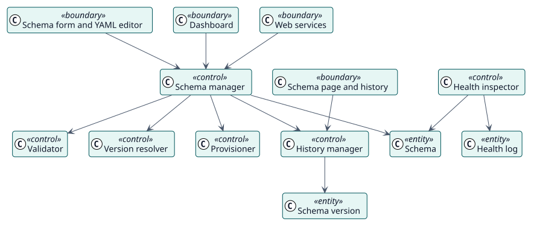

# Analysis

## Analysis classes

Stereotypes: `<<boundary>>` interface, `<<control>>` coordination, `<<entity>>` domain information.

| Class | Stereotype | Responsibility |
| --- | --- | --- |
| Schema form and YAML editor, Schema page and history, Dashboard, Web services | boundary | How maintainers and scripts reach the plugin. |
| Schema manager | control | Creates, updates, deletes, enables and disables schemas. |
| Validator | control | Checks a schema and its role section. |
| Version resolver | control | Works out the version a change is saved with. |
| Provisioner | control | Creates, brings in line and discards the user, the role, the service and the token. |
| History manager | control | Keeps each version, compares and rolls back. |
| Health inspector | control | Checks the functions, the user, the service and the token of a schema. |
| Schema, Schema version, Health log | entity | The stored information. |

## Use-case realizations

| ID | Use case | Collaboration |
| --- | --- | --- |
| UC-001 | [Create a schema](./use-cases/createSchema/README.md) | [collaboration](./use-cases/createSchema/collaboration.svg) |
| UC-002 | [Update a schema](./use-cases/updateSchema/README.md) | [collaboration](./use-cases/updateSchema/collaboration.svg) |
| UC-003 | [Roll back a schema](./use-cases/rollbackSchema/README.md) | [collaboration](./use-cases/rollbackSchema/collaboration.svg) |
| UC-004 | [Check the health of the schemas](./use-cases/checkHealth/README.md) | [collaboration](./use-cases/checkHealth/collaboration.svg) |
