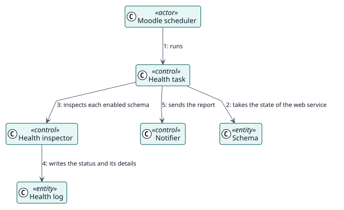

# UC-004 Check the health of the schemas — analysis realization

| Overview | Requirements | Analysis | Design | Implementation | Tests |
| --- | --- | --- | --- | --- | --- |
| [Use cases](../../../requirements/use-case-overview.svg) | [Requirements](../../../requirements/use-cases/checkHealth/README.md) | **Analysis** | [Design](../../../design/use-cases/checkHealth/README.md) | [Implementation](../../../implementation/use-cases/checkHealth/README.md) | [Tests](../../../implementation/use-cases/checkHealth/README.md#tests) |

Requirements: [README](../../../requirements/use-cases/checkHealth/README.md)

## Participating classes

| Class | Stereotype | Responsibility |
| --- | --- | --- |
| Health task | control | Runs the check on the schedule. |
| Health inspector | control | Inspects the functions, the user, the service and the token. |
| Notifier | control | Builds and sends the report. |
| Schema | entity | Holds the status. |
| Health log | entity | Keeps each result. |

## Collaboration

## Notes

Cleaning the old logs and the old versions are their own scheduled tasks and follow the settings of retention.
