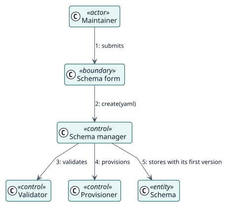

# UC-001 Create a schema — analysis realization

| Overview | Requirements | Analysis | Design | Implementation | Tests |
| --- | --- | --- | --- | --- | --- |
| [Use cases](../../../requirements/use-case-overview.svg) | [Requirements](../../../requirements/use-cases/createSchema/README.md) | **Analysis** | [Design](../../../design/use-cases/createSchema/README.md) | [Implementation](../../../implementation/use-cases/createSchema/README.md) | [Tests](../../../implementation/use-cases/createSchema/README.md#tests) |

Requirements: [README](../../../requirements/use-cases/createSchema/README.md)

## Participating classes

| Class | Stereotype | Responsibility |
| --- | --- | --- |
| Schema form and YAML editor | boundary | Collects the YAML and shows the errors at their fields. |
| Schema manager | control | Coordinates the creation. |
| Validator | control | Checks the schema and its role section. |
| Provisioner | control | Creates the user, the role, the service and the token, and discards them if one fails. |
| Schema | entity | The stored record with its first version. |

## Collaboration

## Notes

Provisioning is one unit: the plugin discards what it created when a later part fails, and also when storing the record fails.
