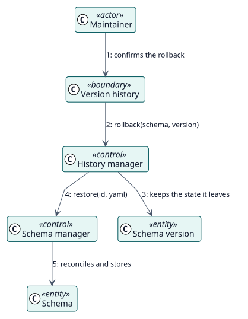

# UC-003 Roll back a schema — analysis realization

| Overview | Requirements | Analysis | Design | Implementation | Tests |
| --- | --- | --- | --- | --- | --- |
| [Use cases](../../../requirements/use-case-overview.svg) | [Requirements](../../../requirements/use-cases/rollbackSchema/README.md) | **Analysis** | [Design](../../../design/use-cases/rollbackSchema/README.md) | [Implementation](../../../implementation/use-cases/rollbackSchema/README.md) | [Tests](../../../implementation/use-cases/rollbackSchema/README.md#tests) |

Requirements: [README](../../../requirements/use-cases/rollbackSchema/README.md)

## Participating classes

| Class | Stereotype | Responsibility |
| --- | --- | --- |
| Version history | boundary | Lists the versions and asks for confirmation. |
| History manager | control | Keeps the backup and restores a version. |
| Schema manager | control | Applies the restored YAML. |
| Schema version | entity | Each stored YAML. |
| Schema | entity | The stored record. |

## Collaboration

## Notes

The backup is saved only when the current state differs from the last version in the history, so a rollback never copies a version that is already there.
