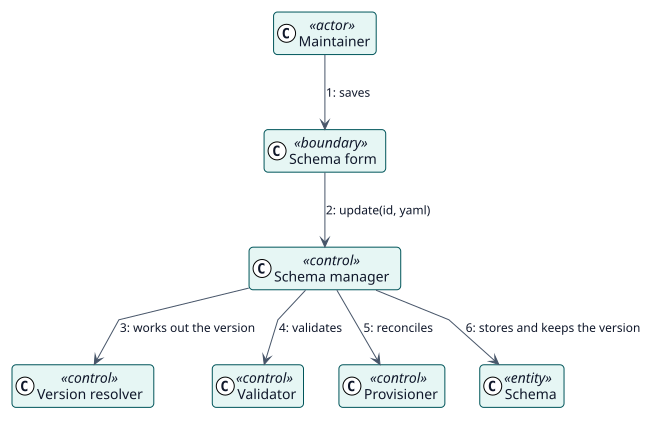

# UC-002 Update a schema — analysis realization

| Overview | Requirements | Analysis | Design | Implementation | Tests |
| --- | --- | --- | --- | --- | --- |
| [Use cases](../../../requirements/use-case-overview.svg) | [Requirements](../../../requirements/use-cases/updateSchema/README.md) | **Analysis** | [Design](../../../design/use-cases/updateSchema/README.md) | [Implementation](../../../implementation/use-cases/updateSchema/README.md) | [Tests](../../../implementation/use-cases/updateSchema/README.md#tests) |

Requirements: [README](../../../requirements/use-cases/updateSchema/README.md)

## Participating classes

| Class | Stereotype | Responsibility |
| --- | --- | --- |
| Schema form and YAML editor | boundary | Shows the schema and collects the changes. |
| Schema manager | control | Coordinates the update. |
| Version resolver | control | Works out the version to save. |
| Validator | control | Checks the schema. |
| Provisioner | control | Brings the user, the role and the service in line. |
| Schema | entity | The stored record. |

## Collaboration

## Notes

The version is worked out before the schema is validated, so forgetting to raise it is never an error.
