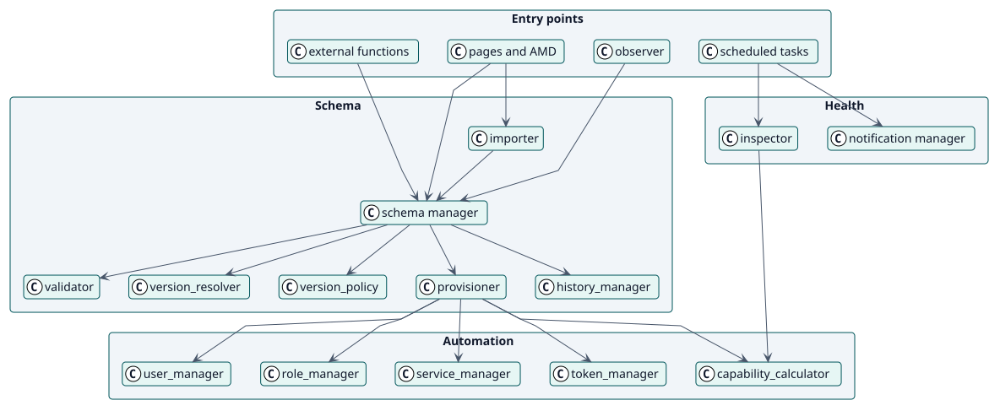
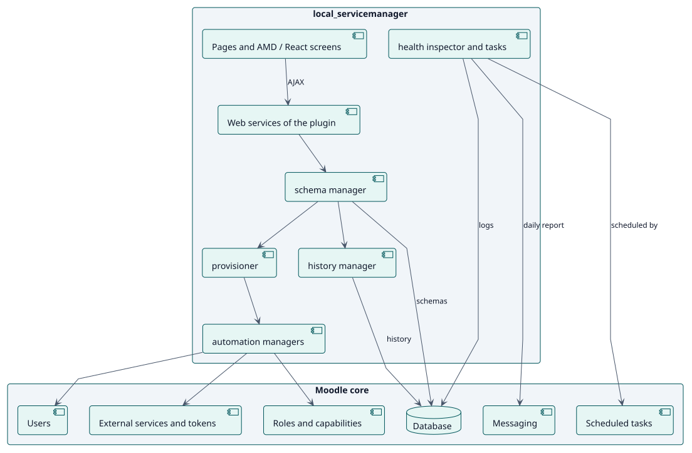
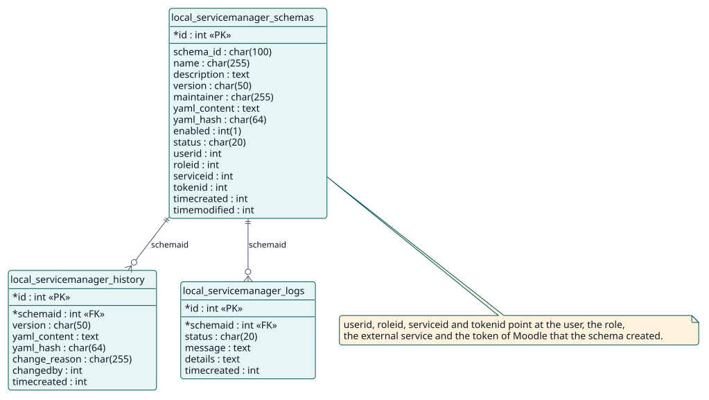

# Design

## Architecture

Web Service Manager is a Moodle local plugin with four groups of classes, observed in the code:

- **Entry points**: the web-service functions (`classes/external/`), the pages and their screens (`pages/`, AMD on 4.0 to 5.2 and React on 5.3), the scheduled tasks (`classes/task/`) and an observer of the events of Moodle.
- **Schema**: the manager that coordinates, the validator, the version resolver and policy, the provisioner, the history manager and the importer.
- **Automation**: one manager each for the user, the role, the service and the token, and the calculator of capabilities.
- **Health**: the inspector, the summary of a status and the notification manager.

Three decisions shape the design. First, the **YAML is the source of truth** and is stored with every version, so the service can always be rebuilt from it. Second, **creating is all or nothing**: the provisioner discards what it created when a part fails. Third, **the capabilities are derived**, not written: the calculator reads what each function needs from the code of Moodle.

## Design classes

## Components

The plugin adds three tables and relies on the external services, roles, users, scheduled tasks and messaging of Moodle. It changes nothing of the core.

## Data model

## Use-case realizations

| ID | Use case | Sequence |
| --- | --- | --- |
| UC-001 | [Create a schema](./use-cases/createSchema/README.md) | [sequence](./use-cases/createSchema/sequence.svg) |
| UC-002 | [Update a schema](./use-cases/updateSchema/README.md) | [sequence](./use-cases/updateSchema/sequence.svg) |
| UC-003 | [Roll back a schema](./use-cases/rollbackSchema/README.md) | [sequence](./use-cases/rollbackSchema/sequence.svg) |
| UC-004 | [Check the health of the schemas](./use-cases/checkHealth/README.md) | [sequence](./use-cases/checkHealth/sequence.svg) |
