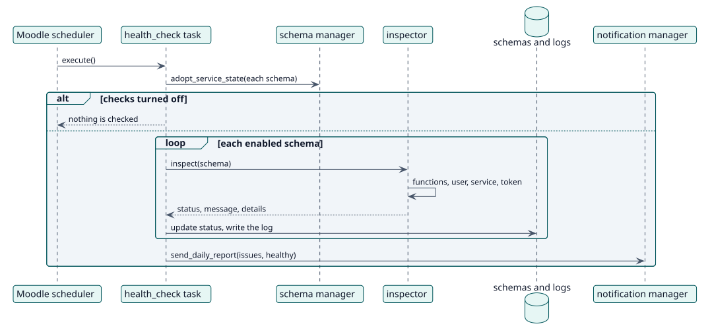

# UC-004 Check the health of the schemas — design realization

| Overview | Requirements | Analysis | Design | Implementation | Tests |
| --- | --- | --- | --- | --- | --- |
| [Use cases](../../../requirements/use-case-overview.svg) | [Requirements](../../../requirements/use-cases/checkHealth/README.md) | [Analysis](../../../analysis/use-cases/checkHealth/README.md) | **Design** | [Implementation](../../../implementation/use-cases/checkHealth/README.md) | [Tests](../../../implementation/use-cases/checkHealth/README.md#tests) |

Analysis: [README](../../../analysis/use-cases/checkHealth/README.md)

## Elements

| Design element | Kind | Code target |
| --- | --- | --- |
| `health_check::execute` | task | `classes/task/health_check.php:48` |
| `inspector::inspect` | service | `classes/health/inspector.php:76` |
| `status_summary::describe` | service | `classes/health/status_summary.php:39` |
| `notification\manager::send_daily_report` | service | `classes/notification/manager.php:41` |

## Sequence

## Contracts

| Operation | Input | Output | Errors |
| --- | --- | --- | --- |
| `inspect(schema)` | a stored schema | status, message and details by area | a stored YAML that cannot be read is critical |

## Data touched

| Table or entity | Operation |
| --- | --- |
| `local_servicemanager_schemas` | read, update (status) |
| `local_servicemanager_logs` | insert |
| `user`, `external_services`, `external_tokens` | read |
