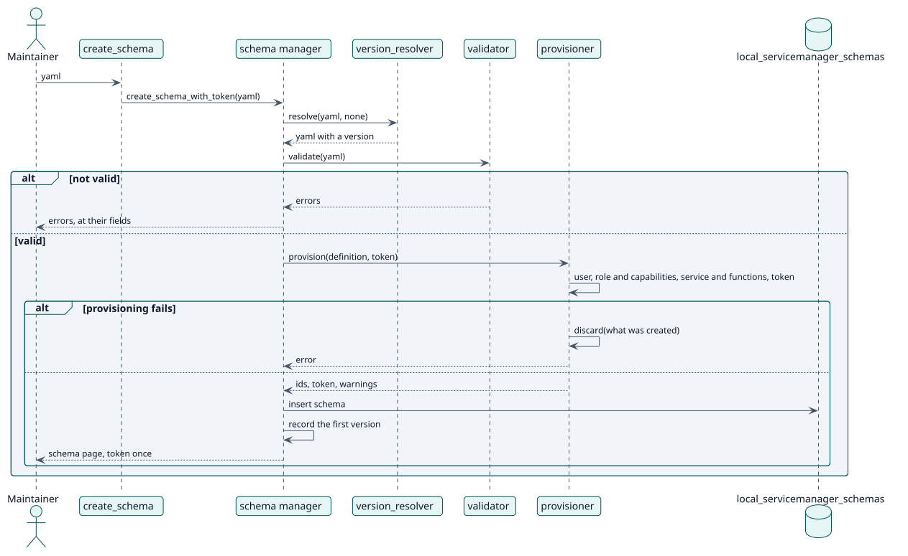

# UC-001 Create a schema — design realization

| Overview | Requirements | Analysis | Design | Implementation | Tests |
| --- | --- | --- | --- | --- | --- |
| [Use cases](../../../requirements/use-case-overview.svg) | [Requirements](../../../requirements/use-cases/createSchema/README.md) | [Analysis](../../../analysis/use-cases/createSchema/README.md) | **Design** | [Implementation](../../../implementation/use-cases/createSchema/README.md) | [Tests](../../../implementation/use-cases/createSchema/README.md#tests) |

Analysis: [README](../../../analysis/use-cases/createSchema/README.md)

## Elements

| Design element | Kind | Code target |
| --- | --- | --- |
| `create_schema` and `create_schema_with_token` of the schema manager | service | `classes/schema/manager.php:65` |
| `validator::validate` | validation | `classes/schema/validator.php:53` |
| `provisioner::provision` and `discard` | service | `classes/schema/provisioner.php:81` |
| `version_resolver::resolve` | service | `classes/schema/version_resolver.php:94` |
| `create_schema` external function | service | `classes/external/create_schema.php` |

## Sequence

## Contracts

| Operation | Input | Output | Errors |
| --- | --- | --- | --- |
| `create_schema_with_token(yaml)` | the YAML of the schema | id, token, warnings | invalid schema, a part that fails to be created |

## Data touched

| Table or entity | Operation |
| --- | --- |
| `local_servicemanager_schemas` | insert |
| `local_servicemanager_history` | insert |
| `user`, `role`, `external_services`, `external_tokens` | insert |
