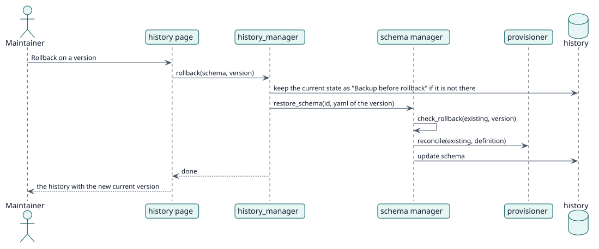

# UC-003 Roll back a schema — design realization

| Overview | Requirements | Analysis | Design | Implementation | Tests |
| --- | --- | --- | --- | --- | --- |
| [Use cases](../../../requirements/use-case-overview.svg) | [Requirements](../../../requirements/use-cases/rollbackSchema/README.md) | [Analysis](../../../analysis/use-cases/rollbackSchema/README.md) | **Design** | [Implementation](../../../implementation/use-cases/rollbackSchema/README.md) | [Tests](../../../implementation/use-cases/rollbackSchema/README.md#tests) |

Analysis: [README](../../../analysis/use-cases/rollbackSchema/README.md)

## Elements

| Design element | Kind | Code target |
| --- | --- | --- |
| `history_manager::rollback` | service | `classes/schema/history_manager.php:129` |
| `manager::restore_schema` | service | `classes/schema/manager.php:102` |
| `version_policy::check_rollback` | validation | `classes/schema/version_policy.php:53` |
| `rollback_schema` external function | service | `classes/external/rollback_schema.php` |

## Sequence

## Contracts

| Operation | Input | Output | Errors |
| --- | --- | --- | --- |
| `rollback(schemaid, historyid)` | the schema and the version | true | the version is not of the schema |

## Data touched

| Table or entity | Operation |
| --- | --- |
| `local_servicemanager_history` | read, insert (backup) |
| `local_servicemanager_schemas` | update |
| `role`, `external_services_functions` | update |
