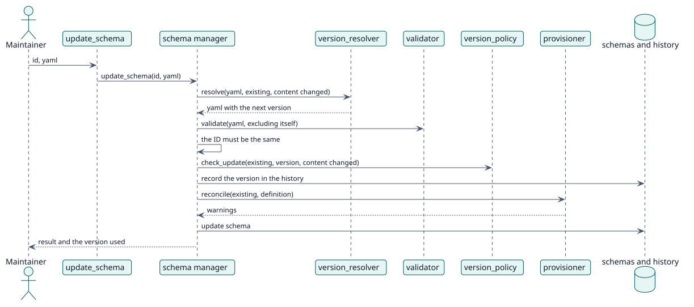

# UC-002 Update a schema — design realization

| Overview | Requirements | Analysis | Design | Implementation | Tests |
| --- | --- | --- | --- | --- | --- |
| [Use cases](../../../requirements/use-case-overview.svg) | [Requirements](../../../requirements/use-cases/updateSchema/README.md) | [Analysis](../../../analysis/use-cases/updateSchema/README.md) | **Design** | [Implementation](../../../implementation/use-cases/updateSchema/README.md) | [Tests](../../../implementation/use-cases/updateSchema/README.md#tests) |

Analysis: [README](../../../analysis/use-cases/updateSchema/README.md)

## Elements

| Design element | Kind | Code target |
| --- | --- | --- |
| `update_schema` of the schema manager | service | `classes/schema/manager.php:88` |
| `version_resolver::resolve` | service | `classes/schema/version_resolver.php:94` |
| `version_policy::check_update` | validation | `classes/schema/version_policy.php:41` |
| `provisioner::reconcile` | service | `classes/schema/provisioner.php:134` |
| `update_schema` external function | service | `classes/external/update_schema.php` |

## Sequence

## Contracts

| Operation | Input | Output | Errors |
| --- | --- | --- | --- |
| `update_schema(id, yaml)` | the id and the new YAML | warnings and the version used | schema not found, the ID changed, invalid schema |

## Data touched

| Table or entity | Operation |
| --- | --- |
| `local_servicemanager_schemas` | update |
| `local_servicemanager_history` | insert |
| `role`, `role_capabilities`, `external_services_functions` | update |
