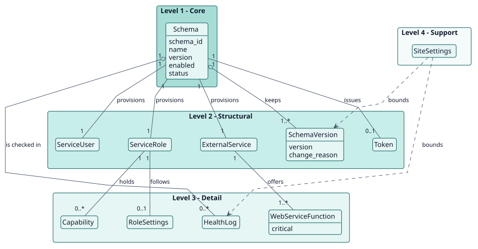
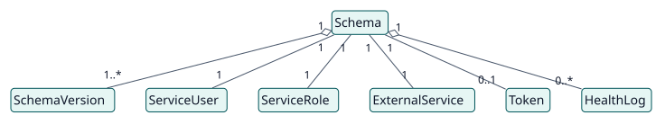
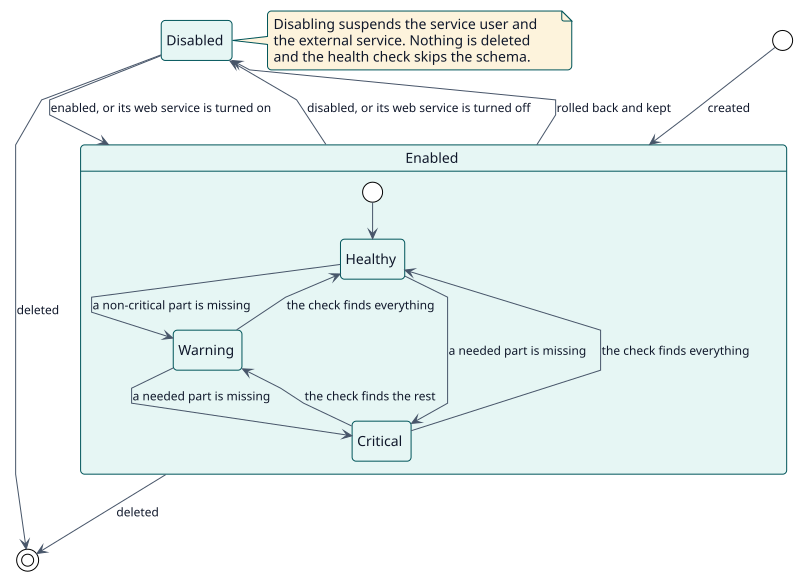

# Domain model

## Purpose

A Moodle site gives web services to the systems around it. Doing it by hand means a user, a role, a list of capabilities, an external service and a token for each consumer, and nothing says whether they still match what was meant. Web Service Manager names that whole as one **schema** and keeps the parts in line with it. This model names the concepts behind that decision.

## Hierarchy of entities

The vertical position of an entity expresses its importance to the project objective. It is not UML inheritance or composition.

| Level | Meaning | Entities | Why they are here |
| --- | --- | --- | --- |
| 1 | Core: the project cannot exist without them | Schema | The plugin exists to turn a description into a service and keep both equal. |
| 2 | Structural: depend directly on the core | SchemaVersion, ServiceUser, ServiceRole, ExternalService, Token | What a schema creates, and the history it keeps. |
| 3 | Detail: qualify or specialise level 2 | WebServiceFunction, Capability, RoleSettings, HealthLog | What defines the service and its role, and the record of its checks. |
| 4 | Support: catalogues, audit, configuration | SiteSettings | Bound the retention of versions and logs and the notifications. |

## Diagrams

## Entity dictionary

| Entity | Level | Definition | Key attributes | Omitted attributes and why |
| --- | --- | --- | --- | --- |
| Schema | 1 | A YAML description of one consumer: its functions, extra capabilities, additional users and role, with the ID and name that identify it. | `schema_id`, `name`, `version`, `enabled`, `status` | Description, maintainer, hash and times are in the [data model](../design/data-model/data-model.svg). |
| SchemaVersion | 2 | A saved state of the YAML of a schema, with who saved it and why. | `version`, `change_reason` | |
| ServiceUser | 2 | The user of Moodle the consumer calls with. | username `ws.{id}` | It is Moodle's `user`, not a table of the plugin. |
| ServiceRole | 2 | The role of that user, with only the capabilities its functions need. | shortname `ws_{id}` | It is Moodle's `role`. |
| ExternalService | 2 | The list of functions the consumer may call. | shortname `ws_{id}` | It is Moodle's `external_services`. |
| Token | 2 | What the consumer sends with every call; shown once. | | It is Moodle's `external_tokens`. |
| WebServiceFunction | 3 | A function of the web services of Moodle that the schema lists, critical or not. | `critical` | |
| Capability | 3 | A capability given to the role: derived from the functions, or extra. | | |
| RoleSettings | 3 | Where the role can be assigned and which roles it may assign, override, switch to and see. | | |
| HealthLog | 3 | The result of one check of a schema. | `status`, `message`, `details` | |
| SiteSettings | 4 | The settings of the plugin: notification, health check, retention of logs and of versions. | | They are Moodle settings, not a table. |

## Business rules

| ID | Rule | Entities | Source |
| --- | --- | --- | --- |
| RN-001 | The ID and the name of a schema are unique, because the names of the role and the service come from them. | Schema | `validator::validate` |
| RN-002 | A critical function that this Moodle does not have blocks the creation; a non-critical one, a missing plugin, a capability that is unknown or an additional user that is not found only warn. | WebServiceFunction | `validator::validate` |
| RN-003 | Everything a schema creates is discarded if any part fails. | Schema | `provisioner::provision` |
| RN-004 | A change of the definition raises the version by itself when it is not higher than the ones the schema has had; changing only the name, the maintainer or the description keeps it. | SchemaVersion | `version_resolver::resolve` |
| RN-005 | The ID of a schema never changes. | Schema | `manager::apply_update` |
| RN-006 | A rollback keeps the state it leaves as a backup. | SchemaVersion | `history_manager::rollback` |
| RN-007 | A rollback is the only way a schema returns to a lower version. | SchemaVersion | `version_policy::check_rollback` |
| RN-008 | A schema takes the worst status of its parts: healthy, warning or critical. | HealthLog | `inspector::inspect` |
| RN-009 | A disabled schema suspends its user and its service and is not checked. | Schema | `provisioner::set_enabled`, `health_check::execute` |

## Lifecycles

State diagram of a schema: [entity-states](./entity-states/entity-states.svg).

