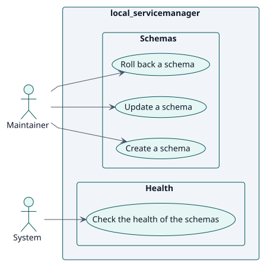
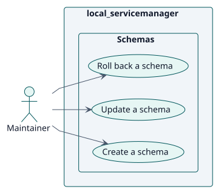
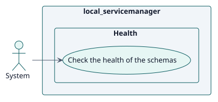

# Requirements

## Index

- [Actors](./actors.md)
- [Requirements catalogue](./requirements.md)

## Use cases

<!-- rup-flow:use-cases:start -->

| ID | Use case | Actor | Package | Requirement | Analysis | Design | Implementation |
| --- | --- | --- | --- | --- | --- | --- | --- |
| UC-001 | [Create a schema](./use-cases/createSchema/README.md) | Maintainer | Schemas | RF-001 | [card](../analysis/use-cases/createSchema/README.md) | [card](../design/use-cases/createSchema/README.md) | [card](../implementation/use-cases/createSchema/README.md) |
| UC-002 | [Update a schema](./use-cases/updateSchema/README.md) | Maintainer | Schemas | RF-002 | [card](../analysis/use-cases/updateSchema/README.md) | [card](../design/use-cases/updateSchema/README.md) | [card](../implementation/use-cases/updateSchema/README.md) |
| UC-003 | [Roll back a schema](./use-cases/rollbackSchema/README.md) | Maintainer | Schemas | RF-003 | [card](../analysis/use-cases/rollbackSchema/README.md) | [card](../design/use-cases/rollbackSchema/README.md) | [card](../implementation/use-cases/rollbackSchema/README.md) |
| UC-004 | [Check the health of the schemas](./use-cases/checkHealth/README.md) | System | Health | RF-004 | [card](../analysis/use-cases/checkHealth/README.md) | [card](../design/use-cases/checkHealth/README.md) | [card](../implementation/use-cases/checkHealth/README.md) |

### Use-case diagram

### By actor

#### Maintainer

#### System

<!-- rup-flow:use-cases:end -->

## Conventions

- `specification.puml` is the behavioural source of truth of a use case: a statechart with the Actor/System conversation.
- `wireframes.puml` is the interface prototype, even when it holds a single screen.
- Each use-case folder holds `README.md`, `specification.puml` and `wireframes.puml`.
