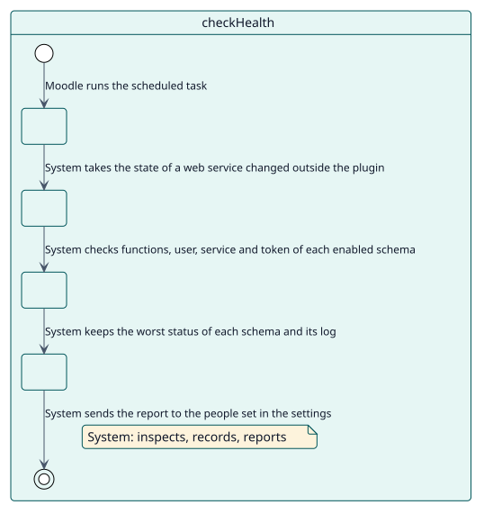
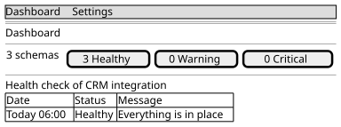

# UC-004 Check the health of the schemas

| Overview | Requirements | Analysis | Design | Implementation | Tests |
| --- | --- | --- | --- | --- | --- |
| [Use cases](../../use-case-overview.svg) | **Requirements** | [Analysis](../../../analysis/use-cases/checkHealth/README.md) | [Design](../../../design/use-cases/checkHealth/README.md) | [Implementation](../../../implementation/use-cases/checkHealth/README.md) | [Tests](../../../implementation/use-cases/checkHealth/README.md#tests) |

## Use-case information

| Field | Value |
| --- | --- |
| Actor | Moodle scheduler |
| Package | Health |
| Goal | Verify on a schedule that what each schema created is still there and works. |
| Type | Primary, essential |
| Level | User goal |
| Requirement | RF-004 |
| Domain entities | Schema, HealthLog, ServiceUser, ExternalService, Token, WebServiceFunction, SiteSettings |

## Context

Someone can delete a user, turn a service off or uninstall a plugin that a function needs. The check finds it before a consumer does.

## Preconditions

- The health check is enabled in the settings of the plugin.

## Postconditions

- Success: every enabled schema has the worst status the check found and a line in its log; the report is sent to the people set in the settings.
- Failure: a schema that cannot be inspected is left as critical with the reason.

## Main flow

| Step | Actor | System |
| --- | --- | --- |
| 1 |  | Takes the state of a web service that was turned on or off without an event, so the state of the schema follows it. |
| 2 |  | Skips the schemas that are disabled. |
| 3 |  | Checks the functions (and whether this Moodle still has them), the service user, the external service and the token of each enabled schema. |
| 4 |  | Leaves the schema as healthy, warning or critical, the worst thing it found, and writes the result in its log. |
| 5 |  | Sends the report of the issues, and of the healthy schemas, to the addresses and the level set in the settings. |

## Alternative flows

| ID | Starts at step | Condition | Behaviour | Ends |
| --- | --- | --- | --- | --- |
| A1 | 1 | The health check is turned off. | Only takes the state of the services; checks nothing. | End |
| A2 | 3 | The stored YAML cannot be read. | Leaves the schema as critical. | Step 5 |

## Business rules

| ID | Rule |
| --- | --- |
| RN-008 | A schema takes the worst status of its parts. |
| RN-009 | A disabled schema is not checked. |

## Specification

Behaviour source of truth: [specification.puml](./specification.puml)

## Wireframes

