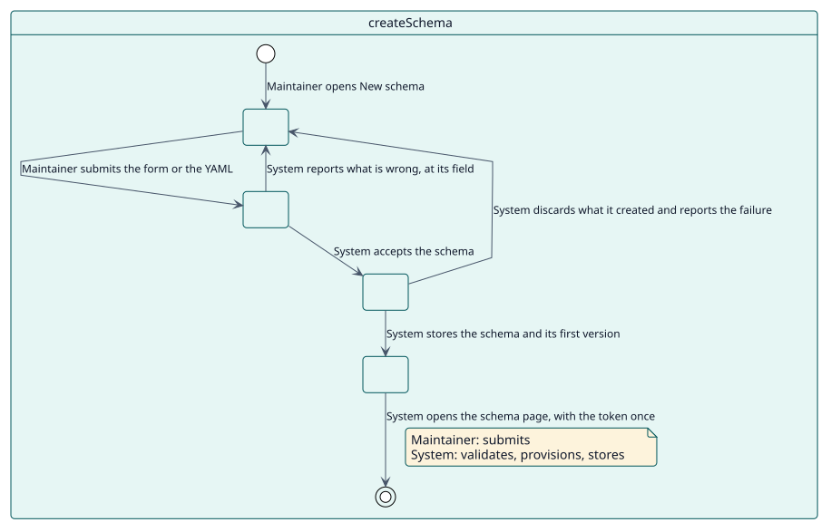
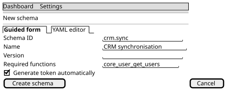

# UC-001 Create a schema

| Overview | Requirements | Analysis | Design | Implementation | Tests |
| --- | --- | --- | --- | --- | --- |
| [Use cases](../../use-case-overview.svg) | **Requirements** | [Analysis](../../../analysis/use-cases/createSchema/README.md) | [Design](../../../design/use-cases/createSchema/README.md) | [Implementation](../../../implementation/use-cases/createSchema/README.md) | [Tests](../../../implementation/use-cases/createSchema/README.md#tests) |

## Use-case information

| Field | Value |
| --- | --- |
| Actor | Maintainer |
| Package | Schemas |
| Goal | Turn a YAML schema into a service user, a role, an external service and a token. |
| Type | Primary, essential |
| Level | User goal |
| Requirement | RF-001 |
| Domain entities | Schema, SchemaVersion, ServiceUser, ServiceRole, ExternalService, Token, WebServiceFunction |

## Context

A consumer of the site needs its own way into the web services. The maintainer describes it in one schema and the plugin builds everything it needs, so the consumer reaches only what the schema declares.

## Preconditions

- The maintainer holds `local/servicemanager:manage`.
- The web services of the site are on, so the service can answer.

## Postconditions

- Success: a schema exists with its first version, a service user, a role with the capabilities of its functions, an external service with those functions and, if asked, a token that is shown once.
- Failure: nothing remains of what was created: the user, the role and the service are discarded.

## Main flow

| Step | Actor | System |
| --- | --- | --- |
| 1 | Opens **New schema** and fills the guided form or writes the YAML. | Shows the two tabs. |
| 2 | Submits. | Gives a version of 1.0.0 to a schema that has none. |
| 3 |  | Validates the ID, the name, the functions, the plugins and the role section. |
| 4 |  | Creates the service user, the role with its capabilities and settings, the external service with its functions and the authorised users, and the token if it was asked for. |
| 5 |  | Stores the schema and its first version in the history. |
| 6 |  | Opens the schema page and shows the token once, with the warnings, if any. |

## Alternative flows

| ID | Starts at step | Condition | Behaviour | Ends |
| --- | --- | --- | --- | --- |
| A1 | 3 | The schema is not valid: a repeated ID or name, a critical function this Moodle lacks, a role that does not exist. | Shows each error at its field; nothing is created. | Step 1 |
| A2 | 4 | Creating any part fails. | Discards what was created and shows the error. | Step 1 |
| A3 | 4 | A function that is not critical, a plugin, a capability or an additional user is missing. | Creates the schema and shows a warning. | Step 5 |

## Business rules

| ID | Rule |
| --- | --- |
| RN-001 | The ID and the name of a schema are unique. |
| RN-002 | A critical function that is missing blocks the creation; a non-critical one only warns. |
| RN-003 | Everything created is discarded if any part fails. |

## Specification

Behaviour source of truth: [specification.puml](./specification.puml)

## Wireframes

