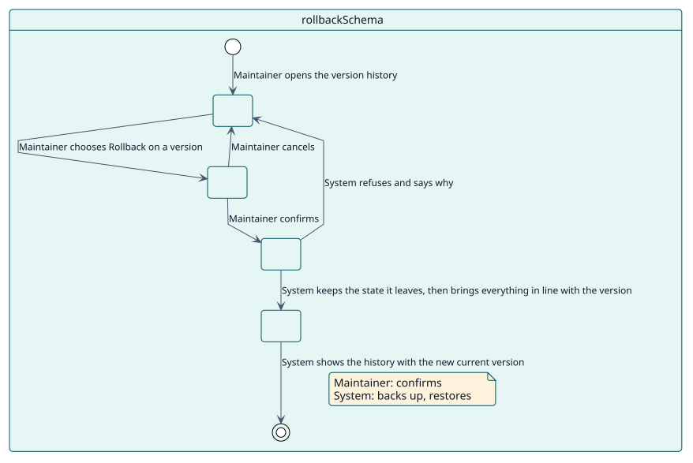
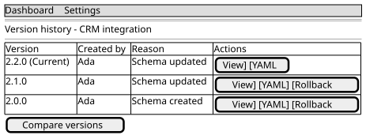

# UC-003 Roll back a schema

| Overview | Requirements | Analysis | Design | Implementation | Tests |
| --- | --- | --- | --- | --- | --- |
| [Use cases](../../use-case-overview.svg) | **Requirements** | [Analysis](../../../analysis/use-cases/rollbackSchema/README.md) | [Design](../../../design/use-cases/rollbackSchema/README.md) | [Implementation](../../../implementation/use-cases/rollbackSchema/README.md) | [Tests](../../../implementation/use-cases/rollbackSchema/README.md#tests) |

## Use-case information

| Field | Value |
| --- | --- |
| Actor | Maintainer |
| Package | Schemas |
| Goal | Return a schema, and what it created, to an earlier version. |
| Type | Primary, essential |
| Level | User goal |
| Requirement | RF-003 |
| Domain entities | Schema, SchemaVersion, ServiceRole, ExternalService |

## Context

A change turned out wrong. The maintainer chooses an earlier version and the plugin brings the schema and everything it created back to it, without losing the state it leaves.

## Preconditions

- The maintainer holds `local/servicemanager:manage`.
- The schema has an earlier version in its history.

## Postconditions

- Success: the schema, its role, its service and its functions match the chosen version; the state that was left is in the history as a backup.
- Failure: the schema stays as it was.

## Main flow

| Step | Actor | System |
| --- | --- | --- |
| 1 | Opens the **Version History** of a schema. | Lists its versions, the current one marked. |
| 2 | Presses **Rollback** on an earlier version. | Asks for confirmation in a window. |
| 3 | Confirms. | Keeps the current state in the history as a backup when it is not there already. |
| 4 |  | Restores the YAML of the chosen version, the only path that may move the version backwards, and brings the user, the role, the service and its functions in line. |
| 5 |  | Shows the history with the new current version, without adding a row for the rollback itself. |

## Alternative flows

| ID | Starts at step | Condition | Behaviour | Ends |
| --- | --- | --- | --- | --- |
| A1 | 2 | The maintainer cancels. | Closes the window and changes nothing. | Step 1 |
| A2 | 4 | The version does not belong to the schema. | Refuses with an error. | Step 1 |

## Business rules

| ID | Rule |
| --- | --- |
| RN-006 | A rollback keeps the state it leaves, so nothing is lost. |
| RN-007 | A rollback is the only way a schema returns to a lower version number. |

## Specification

Behaviour source of truth: [specification.puml](./specification.puml)

## Wireframes

