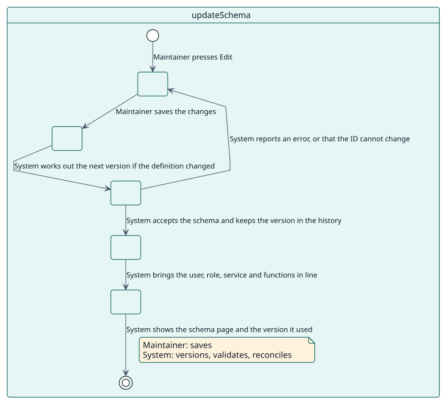
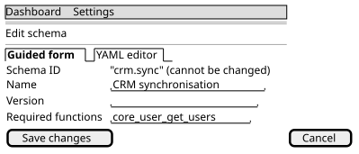

# UC-002 Update a schema

| Overview | Requirements | Analysis | Design | Implementation | Tests |
| --- | --- | --- | --- | --- | --- |
| [Use cases](../../use-case-overview.svg) | **Requirements** | [Analysis](../../../analysis/use-cases/updateSchema/README.md) | [Design](../../../design/use-cases/updateSchema/README.md) | [Implementation](../../../implementation/use-cases/updateSchema/README.md) | [Tests](../../../implementation/use-cases/updateSchema/README.md#tests) |

## Use-case information

| Field | Value |
| --- | --- |
| Actor | Maintainer |
| Package | Schemas |
| Goal | Bring the service in line with a changed schema and keep its version. |
| Type | Primary, essential |
| Level | User goal |
| Requirement | RF-002 |
| Domain entities | Schema, SchemaVersion, ServiceRole, ExternalService, WebServiceFunction, RoleSettings |

## Context

A consumer needs more, or less, than its schema says. The maintainer changes the schema and the plugin brings the role, the service and its functions in line, keeping every version.

## Preconditions

- The maintainer holds `local/servicemanager:manage`.
- The schema exists.

## Postconditions

- Success: the user, the role, the service and its functions match the schema; the new version is in the history; the schema page tells which version was used.
- Failure: the schema stays as it was.

## Main flow

| Step | Actor | System |
| --- | --- | --- |
| 1 | Presses **Edit** on a schema. | Opens the form with the schema filled in. |
| 2 | Changes what is needed and saves. | Works out the next version when the definition changed and the version was left empty, used or lower. |
| 3 |  | Validates the schema, excluding itself, and checks that its ID is the same. |
| 4 |  | Keeps the version in the history. |
| 5 |  | Brings the user, the role, its capabilities and settings, the service and its functions in line: what was added is created and what was removed is taken away. |
| 6 |  | Shows the schema page and the version it used. |

## Alternative flows

| ID | Starts at step | Condition | Behaviour | Ends |
| --- | --- | --- | --- | --- |
| A1 | 3 | The ID was changed. | Refuses: an ID never changes. | Step 2 |
| A2 | 3 | The schema is not valid. | Shows each error at its field. | Step 2 |
| A3 | 2 | Only the name, the maintainer or the description changed. | Keeps the version. | Step 5 |

## Business rules

| ID | Rule |
| --- | --- |
| RN-004 | A change of the definition raises the version by itself when it is not higher than the ones the schema has had. |
| RN-005 | The ID of a schema never changes. |

## Specification

Behaviour source of truth: [specification.puml](./specification.puml)

## Wireframes

