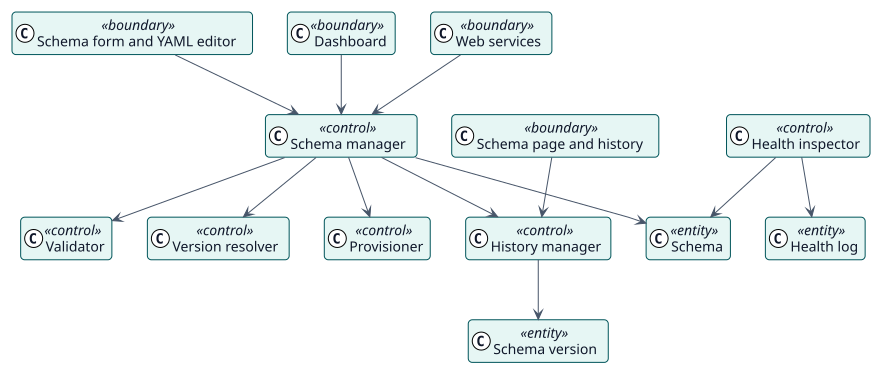

# Análisis

## Clases de análisis

Estereotipos: `<<boundary>>` interfaz, `<<control>>` coordinación, `<<entity>>` información del dominio.

| Clase | Estereotipo | Responsabilidad |
| --- | --- | --- |
| Formulario del esquema y editor YAML, Página del esquema e historial, Panel, Servicios web | frontera | Cómo llegan al plugin los responsables y los scripts. |
| Gestor de esquemas | control | Crea, actualiza, elimina, habilita y deshabilita esquemas. |
| Validador | control | Comprueba un esquema y su sección del rol. |
| Calculador de versiones | control | Calcula la versión con la que se guarda un cambio. |
| Aprovisionador | control | Crea, pone al día y descarta el usuario, el rol, el servicio y el token. |
| Gestor del historial | control | Conserva cada versión, compara y deshace. |
| Inspector de salud | control | Comprueba las funciones, el usuario, el servicio y el token de un esquema. |
| Esquema, Versión del esquema, Registro de salud | entidad | La información guardada. |

## Realizaciones de los casos de uso

| ID | Caso de uso | Colaboración |
| --- | --- | --- |
| UC-001 | [Crear un esquema](./use-cases/createSchema/README.md) | [colaboración](./use-cases/createSchema/collaboration.svg) |
| UC-002 | [Actualizar un esquema](./use-cases/updateSchema/README.md) | [colaboración](./use-cases/updateSchema/collaboration.svg) |
| UC-003 | [Deshacer hasta una versión](./use-cases/rollbackSchema/README.md) | [colaboración](./use-cases/rollbackSchema/collaboration.svg) |
| UC-004 | [Comprobar la salud de los esquemas](./use-cases/checkHealth/README.md) | [colaboración](./use-cases/checkHealth/collaboration.svg) |
