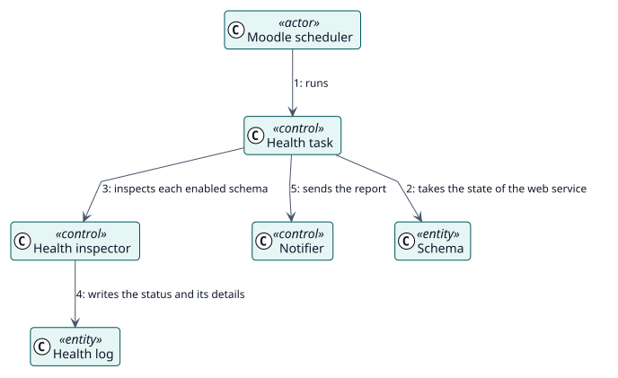

# UC-004 Comprobar la salud de los esquemas — realización del análisis

| Resumen | Requisitos | Análisis | Diseño | Implementación | Pruebas |
| --- | --- | --- | --- | --- | --- |
| [Casos de uso](../../../requirements/use-case-overview.svg) | [Requisitos](../../../requirements/use-cases/checkHealth/README.md) | **Análisis** | [Diseño](../../../design/use-cases/checkHealth/README.md) | [Implementación](../../../implementation/use-cases/checkHealth/README.md) | [Pruebas](../../../implementation/use-cases/checkHealth/README.md#pruebas) |

Requisitos: [README](../../../requirements/use-cases/checkHealth/README.md)

## Clases participantes

| Clase | Estereotipo | Responsabilidad |
| --- | --- | --- |
| Tarea de salud | control | Ejecuta la comprobación según el calendario. |
| Inspector de salud | control | Inspecciona las funciones, el usuario, el servicio y el token. |
| Notificador | control | Construye y envía el informe. |
| Esquema | entidad | Guarda el estado. |
| Registro de salud | entidad | Conserva cada resultado. |

## Colaboración

## Notas

La limpieza de los registros y de las versiones antiguas son tareas programadas propias y siguen los ajustes de retención.
