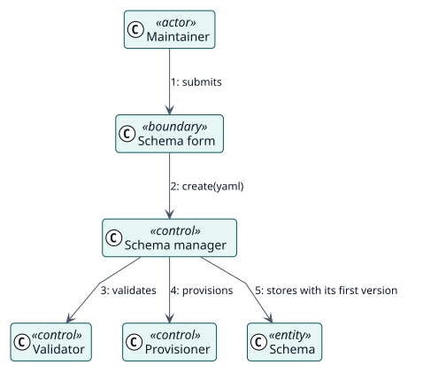

# UC-001 Crear un esquema — realización del análisis

| Resumen | Requisitos | Análisis | Diseño | Implementación | Pruebas |
| --- | --- | --- | --- | --- | --- |
| [Casos de uso](../../../requirements/use-case-overview.svg) | [Requisitos](../../../requirements/use-cases/createSchema/README.md) | **Análisis** | [Diseño](../../../design/use-cases/createSchema/README.md) | [Implementación](../../../implementation/use-cases/createSchema/README.md) | [Pruebas](../../../implementation/use-cases/createSchema/README.md#pruebas) |

Requisitos: [README](../../../requirements/use-cases/createSchema/README.md)

## Clases participantes

| Clase | Estereotipo | Responsabilidad |
| --- | --- | --- |
| Formulario del esquema y editor YAML | frontera | Recoge el YAML y muestra los errores en sus campos. |
| Gestor de esquemas | control | Coordina la creación. |
| Validador | control | Comprueba el esquema y su sección del rol. |
| Aprovisionador | control | Crea el usuario, el rol, el servicio y el token, y los descarta si uno falla. |
| Esquema | entidad | El registro guardado con su primera versión. |

## Colaboración

## Notas

El aprovisionamiento es una unidad: el plugin descarta lo que creó cuando falla una parte posterior, y también cuando falla guardar el registro.
