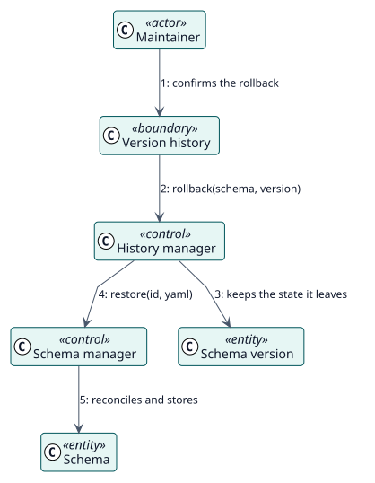

# UC-003 Deshacer hasta una versión — realización del análisis

| Resumen | Requisitos | Análisis | Diseño | Implementación | Pruebas |
| --- | --- | --- | --- | --- | --- |
| [Casos de uso](../../../requirements/use-case-overview.svg) | [Requisitos](../../../requirements/use-cases/rollbackSchema/README.md) | **Análisis** | [Diseño](../../../design/use-cases/rollbackSchema/README.md) | [Implementación](../../../implementation/use-cases/rollbackSchema/README.md) | [Pruebas](../../../implementation/use-cases/rollbackSchema/README.md#pruebas) |

Requisitos: [README](../../../requirements/use-cases/rollbackSchema/README.md)

## Clases participantes

| Clase | Estereotipo | Responsabilidad |
| --- | --- | --- |
| Historial de versiones | frontera | Lista las versiones y pide confirmación. |
| Gestor del historial | control | Guarda la copia de seguridad y restaura una versión. |
| Gestor de esquemas | control | Aplica el YAML restaurado. |
| Versión del esquema | entidad | Cada YAML guardado. |
| Esquema | entidad | El registro guardado. |

## Colaboración

## Notas

La copia de seguridad se guarda solo cuando el estado actual difiere de la última versión del historial, así que un retroceso nunca copia una versión que ya está.
