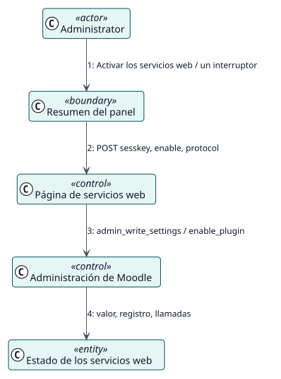

# UC-005 Activar o desactivar los servicios web y sus protocolos

| Vista general | Requisitos | Análisis | Diseño | Implementación | Pruebas |
| --- | --- | --- | --- | --- | --- |
| [Casos de uso](../../../requirements/use-case-overview.svg) | [Requisitos](../../../requirements/use-cases/turnWebServices/README.md) | **Análisis** | [Diseño](../../../design/use-cases/turnWebServices/README.md) | [Implementación](../../../implementation/use-cases/turnWebServices/README.md) | [Pruebas](../../../implementation/use-cases/turnWebServices/README.md#tests) |

## Clases participantes

| Clase | Estereotipo | Responsabilidad |
| --- | --- | --- |
| Resumen del panel | boundary | Muestra el estado y los interruptores, y pregunta antes de desactivar los servicios web. |
| Página de servicios web | control | Comprueba a la persona y escribe el ajuste. |
| Administración de Moodle | control | Escribe un ajuste con su registro y sus llamadas posteriores. |
| Estado de los servicios web | entity | Si los servicios web están activados, y qué protocolos. |

## Colaboración

## Notas

La página no escribe el ajuste por su cuenta: pasa por las mismas funciones que la administración de Moodle, de modo que el registro de la configuración y las llamadas posteriores son las de cualquier otro cambio.
