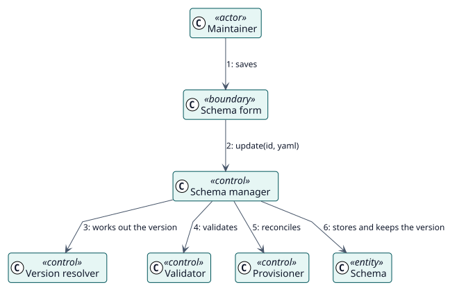

# UC-002 Actualizar un esquema — realización del análisis

| Resumen | Requisitos | Análisis | Diseño | Implementación | Pruebas |
| --- | --- | --- | --- | --- | --- |
| [Casos de uso](../../../requirements/use-case-overview.svg) | [Requisitos](../../../requirements/use-cases/updateSchema/README.md) | **Análisis** | [Diseño](../../../design/use-cases/updateSchema/README.md) | [Implementación](../../../implementation/use-cases/updateSchema/README.md) | [Pruebas](../../../implementation/use-cases/updateSchema/README.md#pruebas) |

Requisitos: [README](../../../requirements/use-cases/updateSchema/README.md)

## Clases participantes

| Clase | Estereotipo | Responsabilidad |
| --- | --- | --- |
| Formulario del esquema y editor YAML | frontera | Muestra el esquema y recoge los cambios. |
| Gestor de esquemas | control | Coordina la actualización. |
| Calculador de versiones | control | Calcula la versión que se guarda. |
| Validador | control | Comprueba el esquema. |
| Aprovisionador | control | Pone al día el usuario, el rol y el servicio. |
| Esquema | entidad | El registro guardado. |

## Colaboración

## Notas

La versión se calcula antes de validar el esquema, así que olvidar subirla nunca es un error.
