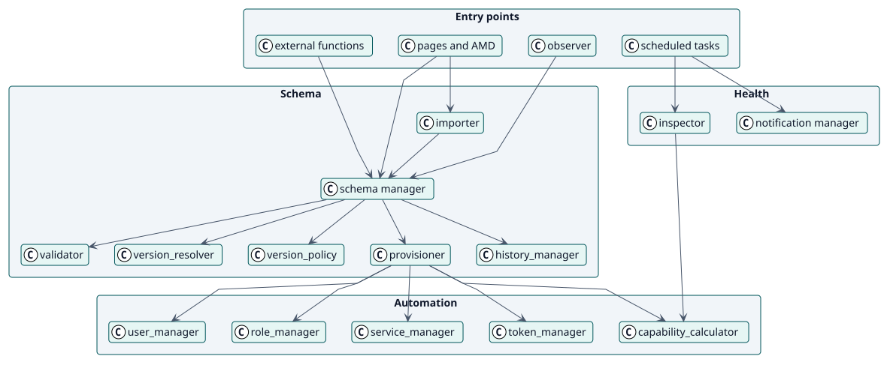
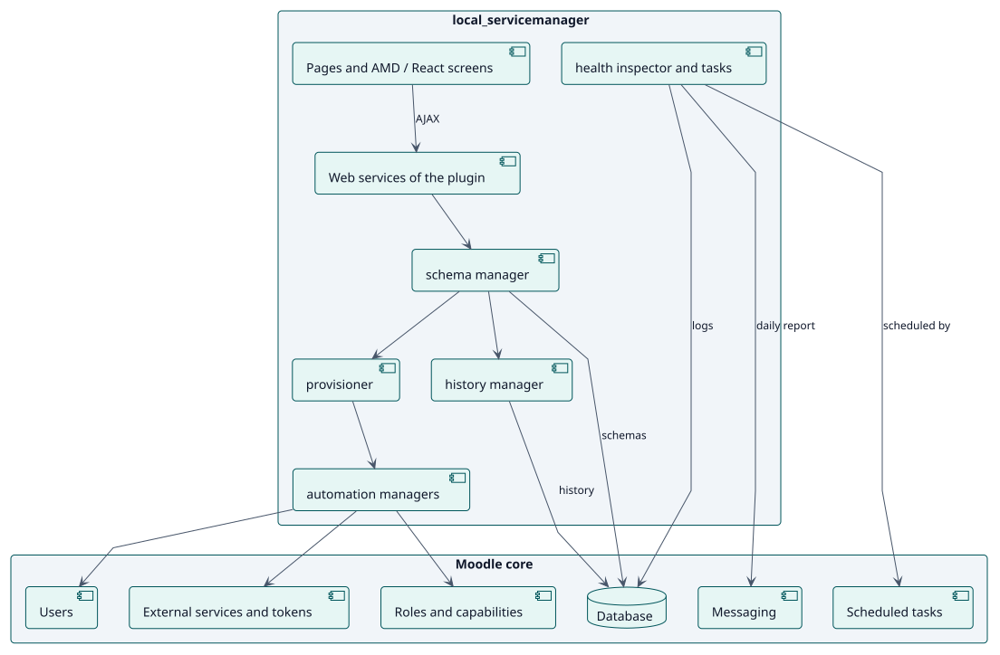
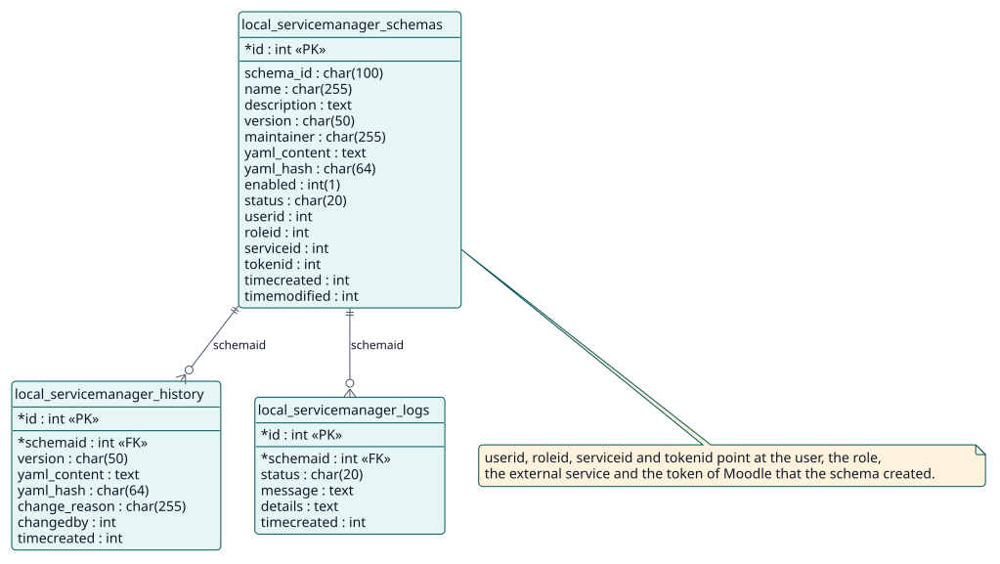

# Diseño

## Arquitectura

Web Service Manager es un plugin local de Moodle con cuatro grupos de clases, observados en el código:

- **Puntos de entrada**: las funciones de servicio web (`classes/external/`), las páginas y sus pantallas (`pages/`, AMD en 4.0 a 5.2 y React en 5.3), las tareas programadas (`classes/task/`) y un observador de los eventos de Moodle.
- **Esquema**: el gestor que coordina, el validador, el calculador y la política de versiones, el aprovisionador, el gestor del historial y el importador.
- **Automatización**: un gestor para cada uno de el usuario, el rol, el servicio y el token, y el calculador de capacidades.
- **Salud**: el inspector, el resumen de un estado y el gestor de notificaciones.

Tres decisiones dan forma al diseño. Primera: **el YAML es la fuente de verdad** y se guarda con cada versión, así que el servicio siempre puede reconstruirse a partir de él. Segunda: **crear es todo o nada**: el aprovisionador descarta lo que creó cuando falla una parte. Tercera: **las capacidades se derivan**, no se escriben: el calculador lee de Moodle lo que necesita cada función.

## Clases de diseño

## Componentes

El plugin añade tres tablas y se apoya en los servicios externos, roles, usuarios, tareas programadas y mensajería de Moodle. No cambia nada del núcleo.

## Modelo de datos

## Realizaciones de los casos de uso

| ID | Caso de uso | Secuencia |
| --- | --- | --- |
| UC-001 | [Crear un esquema](./use-cases/createSchema/README.md) | [secuencia](./use-cases/createSchema/sequence.svg) |
| UC-002 | [Actualizar un esquema](./use-cases/updateSchema/README.md) | [secuencia](./use-cases/updateSchema/sequence.svg) |
| UC-003 | [Deshacer hasta una versión](./use-cases/rollbackSchema/README.md) | [secuencia](./use-cases/rollbackSchema/sequence.svg) |
| UC-004 | [Comprobar la salud de los esquemas](./use-cases/checkHealth/README.md) | [secuencia](./use-cases/checkHealth/sequence.svg) |
