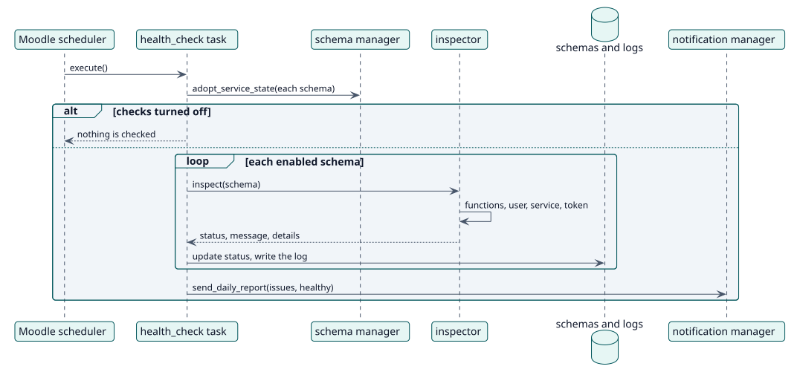

# UC-004 Comprobar la salud de los esquemas — realización del diseño

| Resumen | Requisitos | Análisis | Diseño | Implementación | Pruebas |
| --- | --- | --- | --- | --- | --- |
| [Casos de uso](../../../requirements/use-case-overview.svg) | [Requisitos](../../../requirements/use-cases/checkHealth/README.md) | [Análisis](../../../analysis/use-cases/checkHealth/README.md) | **Diseño** | [Implementación](../../../implementation/use-cases/checkHealth/README.md) | [Pruebas](../../../implementation/use-cases/checkHealth/README.md#pruebas) |

Análisis: [README](../../../analysis/use-cases/checkHealth/README.md)

## Elementos

| Elemento de diseño | Tipo | Código |
| --- | --- | --- |
| `health_check::execute` | tarea | `classes/task/health_check.php:48` |
| `inspector::inspect` | servicio | `classes/health/inspector.php:76` |
| `status_summary::describe` | servicio | `classes/health/status_summary.php:39` |
| `notification\manager::send_daily_report` | servicio | `classes/notification/manager.php:41` |

## Secuencia

## Contratos

| Operación | Entrada | Salida | Errores |
| --- | --- | --- | --- |
| `inspect(schema)` | un esquema guardado | estado, mensaje y detalles por área | un YAML guardado que no se puede leer es crítico |

## Datos que toca

| Tabla o entidad | Operación |
| --- | --- |
| `local_servicemanager_schemas` | lectura, actualización (estado) |
| `local_servicemanager_logs` | inserción |
| `user`, `external_services`, `external_tokens` | lectura |
