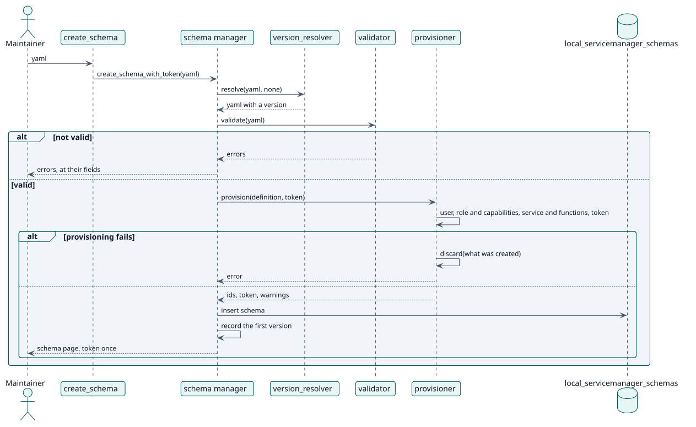

# UC-001 Crear un esquema — realización del diseño

| Resumen | Requisitos | Análisis | Diseño | Implementación | Pruebas |
| --- | --- | --- | --- | --- | --- |
| [Casos de uso](../../../requirements/use-case-overview.svg) | [Requisitos](../../../requirements/use-cases/createSchema/README.md) | [Análisis](../../../analysis/use-cases/createSchema/README.md) | **Diseño** | [Implementación](../../../implementation/use-cases/createSchema/README.md) | [Pruebas](../../../implementation/use-cases/createSchema/README.md#pruebas) |

Análisis: [README](../../../analysis/use-cases/createSchema/README.md)

## Elementos

| Elemento de diseño | Tipo | Código |
| --- | --- | --- |
| `create_schema` y `create_schema_with_token` del gestor de esquemas | servicio | `classes/schema/manager.php:65` |
| `validator::validate` | validación | `classes/schema/validator.php:53` |
| `provisioner::provision` y `discard` | servicio | `classes/schema/provisioner.php:81` |
| `version_resolver::resolve` | servicio | `classes/schema/version_resolver.php:94` |
| Función externa `create_schema` | servicio | `classes/external/create_schema.php` |

## Secuencia

## Contratos

| Operación | Entrada | Salida | Errores |
| --- | --- | --- | --- |
| `create_schema_with_token(yaml)` | el YAML del esquema | id, token, avisos | esquema no válido, una parte que no se puede crear |

## Datos que toca

| Tabla o entidad | Operación |
| --- | --- |
| `local_servicemanager_schemas` | inserción |
| `local_servicemanager_history` | inserción |
| `user`, `role`, `external_services`, `external_tokens` | inserción |
