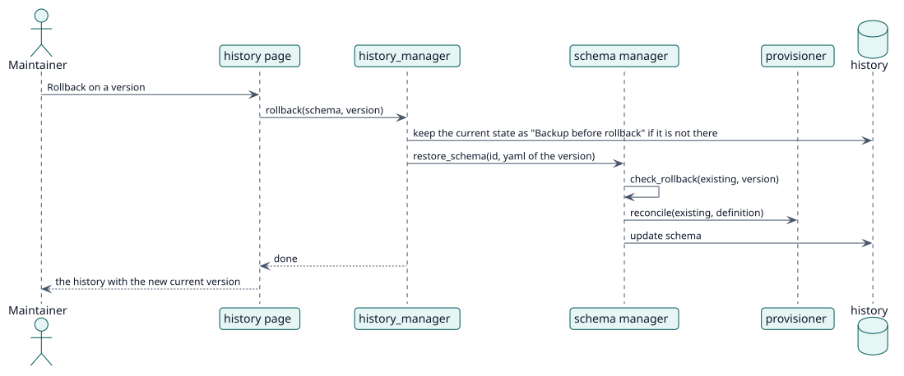

# UC-003 Deshacer hasta una versión — realización del diseño

| Resumen | Requisitos | Análisis | Diseño | Implementación | Pruebas |
| --- | --- | --- | --- | --- | --- |
| [Casos de uso](../../../requirements/use-case-overview.svg) | [Requisitos](../../../requirements/use-cases/rollbackSchema/README.md) | [Análisis](../../../analysis/use-cases/rollbackSchema/README.md) | **Diseño** | [Implementación](../../../implementation/use-cases/rollbackSchema/README.md) | [Pruebas](../../../implementation/use-cases/rollbackSchema/README.md#pruebas) |

Análisis: [README](../../../analysis/use-cases/rollbackSchema/README.md)

## Elementos

| Elemento de diseño | Tipo | Código |
| --- | --- | --- |
| `history_manager::rollback` | servicio | `classes/schema/history_manager.php:129` |
| `manager::restore_schema` | servicio | `classes/schema/manager.php:102` |
| `version_policy::check_rollback` | validación | `classes/schema/version_policy.php:53` |
| Función externa `rollback_schema` | servicio | `classes/external/rollback_schema.php` |

## Secuencia

## Contratos

| Operación | Entrada | Salida | Errores |
| --- | --- | --- | --- |
| `rollback(schemaid, historyid)` | el esquema y la versión | true | la versión no es del esquema |

## Datos que toca

| Tabla o entidad | Operación |
| --- | --- |
| `local_servicemanager_history` | lectura, inserción (copia) |
| `local_servicemanager_schemas` | actualización |
| `role`, `external_services_functions` | actualización |
