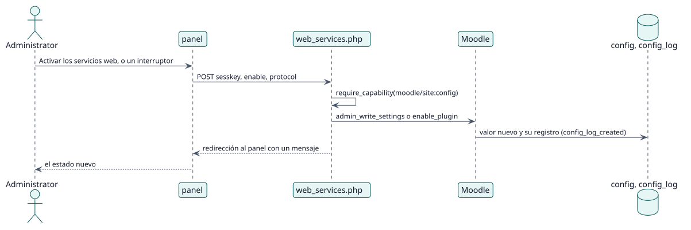

# UC-005 Activar o desactivar los servicios web y sus protocolos

| Vista general | Requisitos | Análisis | Diseño | Implementación | Pruebas |
| --- | --- | --- | --- | --- | --- |
| [Casos de uso](../../../requirements/use-case-overview.svg) | [Requisitos](../../../requirements/use-cases/turnWebServices/README.md) | [Análisis](../../../analysis/use-cases/turnWebServices/README.md) | **Diseño** | [Implementación](../../../implementation/use-cases/turnWebServices/README.md) | [Pruebas](../../../implementation/use-cases/turnWebServices/README.md#tests) |

## Elementos

| Elemento de diseño | Tipo | Destino en el código |
| --- | --- | --- |
| `pages/web_services.php` | página | `pages/web_services.php` |
| `admin_write_settings` | servicio de Moodle | `lib/adminlib.php` |
| `webservice::enable_plugin` | servicio de Moodle | `lib/classes/plugininfo/webservice.php` |
| `ws_status::describe` | modelo de vista | `classes/output/ws_status.php` |

## Secuencia

## Contratos

| Operación | Entrada | Salida | Errores |
| --- | --- | --- | --- |
| POST `pages/web_services.php` | `sesskey`, `enable`, `protocol` y `returnurl` opcionales | la página pedida, con un mensaje | sin capacidad, una clave de sesión errónea, un protocolo que no está instalado |

## Datos afectados

| Tabla o entidad | Operación |
| --- | --- |
| `config` (`enablewebservices`, `webserviceprotocols`) | actualización |
| `config_log` | inserción |
