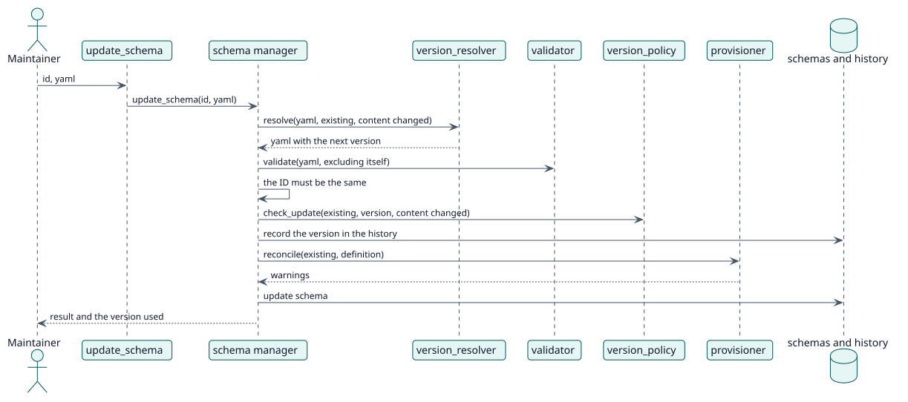

# UC-002 Actualizar un esquema — realización del diseño

| Resumen | Requisitos | Análisis | Diseño | Implementación | Pruebas |
| --- | --- | --- | --- | --- | --- |
| [Casos de uso](../../../requirements/use-case-overview.svg) | [Requisitos](../../../requirements/use-cases/updateSchema/README.md) | [Análisis](../../../analysis/use-cases/updateSchema/README.md) | **Diseño** | [Implementación](../../../implementation/use-cases/updateSchema/README.md) | [Pruebas](../../../implementation/use-cases/updateSchema/README.md#pruebas) |

Análisis: [README](../../../analysis/use-cases/updateSchema/README.md)

## Elementos

| Elemento de diseño | Tipo | Código |
| --- | --- | --- |
| `update_schema` del gestor de esquemas | servicio | `classes/schema/manager.php:88` |
| `version_resolver::resolve` | servicio | `classes/schema/version_resolver.php:94` |
| `version_policy::check_update` | validación | `classes/schema/version_policy.php:41` |
| `provisioner::reconcile` | servicio | `classes/schema/provisioner.php:134` |
| Función externa `update_schema` | servicio | `classes/external/update_schema.php` |

## Secuencia

## Contratos

| Operación | Entrada | Salida | Errores |
| --- | --- | --- | --- |
| `update_schema(id, yaml)` | el id y el nuevo YAML | avisos y la versión usada | esquema no encontrado, ID cambiado, esquema no válido |

## Datos que toca

| Tabla o entidad | Operación |
| --- | --- |
| `local_servicemanager_schemas` | actualización |
| `local_servicemanager_history` | inserción |
| `role`, `role_capabilities`, `external_services_functions` | actualización |
