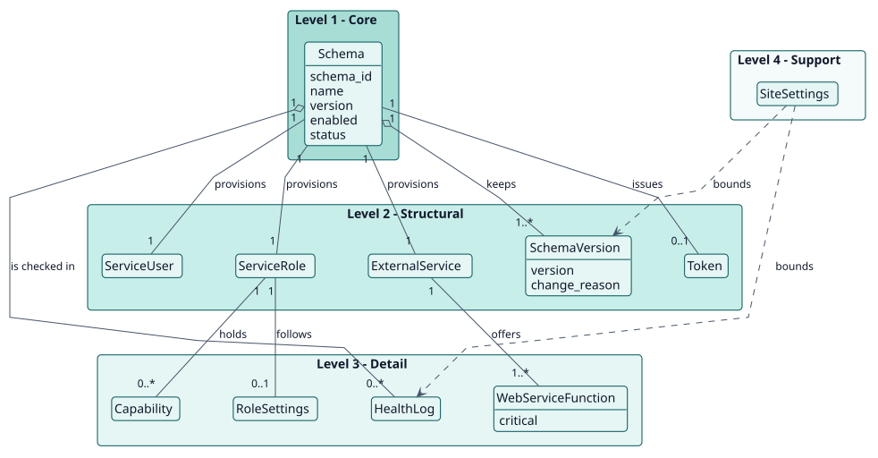
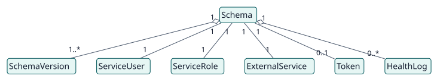
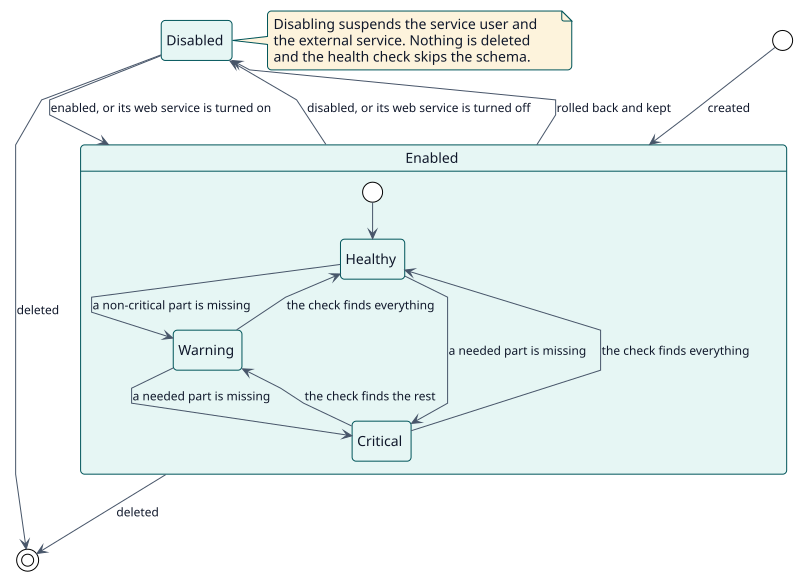

# Modelo de dominio

## Propósito

Un sitio Moodle da servicios web a los sistemas que lo rodean. Hacerlo a mano supone un usuario, un rol, una lista de capacidades, un servicio externo y un token por cada consumidor, y nada dice si siguen coincidiendo con lo que se quería. Web Service Manager nombra ese conjunto como un **esquema** y mantiene las partes al día con él. Este modelo nombra los conceptos que hay detrás de esa decisión.

## Jerarquía de entidades

La posición vertical de una entidad expresa su importancia para el objetivo del proyecto. No es herencia ni composición UML.

| Nivel | Significado | Entidades | Por qué están aquí |
| --- | --- | --- | --- |
| 1 | Núcleo: el proyecto no puede existir sin ellas | Schema | El plugin existe para convertir una descripción en un servicio y mantener ambos iguales. |
| 2 | Estructurales: dependen directamente del núcleo | SchemaVersion, ServiceUser, ServiceRole, ExternalService, Token | Lo que crea un esquema, y el historial que conserva. |
| 3 | Detalle: cualifican o especializan el nivel 2 | WebServiceFunction, Capability, RoleSettings, HealthLog | Lo que define el servicio y su rol, y el registro de sus comprobaciones. |
| 4 | Soporte: catálogos, auditoría, configuración | SiteSettings | Acotan la retención de versiones y registros y las notificaciones. |

## Diagramas

## Diccionario de entidades

| Entidad | Nivel | Definición | Atributos clave | Atributos omitidos y por qué |
| --- | --- | --- | --- | --- |
| Schema | 1 | Una descripción YAML de un consumidor: sus funciones, capacidades adicionales, usuarios adicionales y rol, con el ID y el nombre que lo identifican. | `schema_id`, `name`, `version`, `enabled`, `status` | La descripción, el responsable, el hash y las fechas están en el [modelo de datos](../design/data-model/data-model.svg). |
| SchemaVersion | 2 | Un estado guardado del YAML de un esquema, con quién lo guardó y por qué. | `version`, `change_reason` | |
| ServiceUser | 2 | El usuario de Moodle con el que llama el consumidor. | nombre de usuario `ws.{id}` | Es el `user` de Moodle, no una tabla del plugin. |
| ServiceRole | 2 | El rol de ese usuario, con solo las capacidades que necesitan sus funciones. | nombre corto `ws_{id}` | Es el `role` de Moodle. |
| ExternalService | 2 | La lista de funciones que el consumidor puede llamar. | nombre corto `ws_{id}` | Es el `external_services` de Moodle. |
| Token | 2 | Lo que el consumidor envía en cada llamada; se muestra una vez. | | Es el `external_tokens` de Moodle. |
| WebServiceFunction | 3 | Una función de los servicios web de Moodle que lista el esquema, crítica o no. | `critical` | |
| Capability | 3 | Una capacidad dada al rol: derivada de las funciones, o adicional. | | |
| RoleSettings | 3 | Dónde puede asignarse el rol y qué roles puede asignar, anular, cambiar y ver. | | |
| HealthLog | 3 | El resultado de una comprobación de un esquema. | `status`, `message`, `details` | |
| SiteSettings | 4 | Los ajustes del plugin: notificación, comprobación de salud, retención de registros y de versiones. | | Son ajustes de Moodle, no una tabla. |

## Reglas de negocio

| ID | Regla | Entidades | Fuente |
| --- | --- | --- | --- |
| RN-001 | El ID y el nombre de un esquema son únicos, porque de ellos salen los nombres del rol y del servicio. | Schema | `validator::validate` |
| RN-002 | Una función crítica que este Moodle no tiene bloquea la creación; una no crítica, un plugin ausente, una capacidad desconocida o un usuario adicional que no se encuentra solo avisan. | WebServiceFunction | `validator::validate` |
| RN-003 | Todo lo que crea un esquema se descarta si alguna parte falla. | Schema | `provisioner::provision` |
| RN-004 | Un cambio de la definición sube la versión por sí mismo cuando no es más alta que las que ha tenido el esquema; cambiar solo el nombre, el responsable o la descripción la conserva. | SchemaVersion | `version_resolver::resolve` |
| RN-005 | El ID de un esquema no cambia nunca. | Schema | `manager::apply_update` |
| RN-006 | Un retroceso conserva como copia de seguridad el estado que deja. | SchemaVersion | `history_manager::rollback` |
| RN-007 | Un retroceso es la única forma en que un esquema vuelve a una versión más baja. | SchemaVersion | `version_policy::check_rollback` |
| RN-008 | Un esquema toma el peor estado de sus partes: correcto, con aviso o crítico. | HealthLog | `inspector::inspect` |
| RN-009 | Un esquema deshabilitado suspende su usuario y su servicio y no se comprueba. | Schema | `provisioner::set_enabled`, `health_check::execute` |

## Ciclos de vida

Diagrama de estados de un esquema: [entity-states](./entity-states/entity-states.svg).

