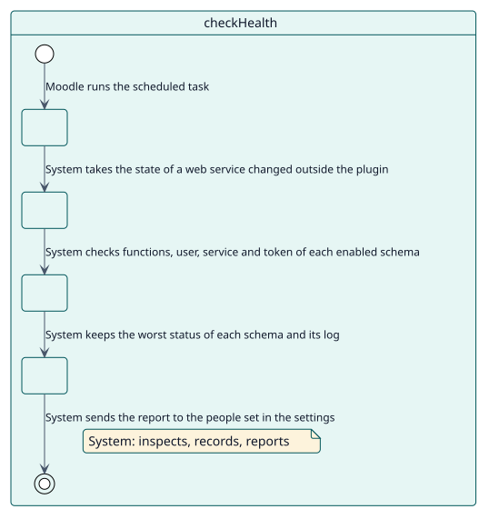
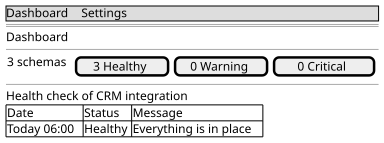

# UC-004 Comprobar la salud de los esquemas

| Resumen | Requisitos | Análisis | Diseño | Implementación | Pruebas |
| --- | --- | --- | --- | --- | --- |
| [Casos de uso](../../use-case-overview.svg) | **Requisitos** | [Análisis](../../../analysis/use-cases/checkHealth/README.md) | [Diseño](../../../design/use-cases/checkHealth/README.md) | [Implementación](../../../implementation/use-cases/checkHealth/README.md) | [Pruebas](../../../implementation/use-cases/checkHealth/README.md#pruebas) |

## Información del caso de uso

| Campo | Valor |
| --- | --- |
| Actor | Planificador de Moodle |
| Paquete | Health |
| Objetivo | Verificar según un calendario que lo que creó cada esquema sigue ahí y funciona. |
| Tipo | Primario, esencial |
| Nivel | Objetivo de usuario |
| Requisito | RF-004 |
| Entidades del dominio | Schema, HealthLog, ServiceUser, ExternalService, Token, WebServiceFunction, SiteSettings |

## Contexto

Alguien puede borrar un usuario, apagar un servicio o desinstalar un plugin que necesita una función. La comprobación lo encuentra antes que un consumidor.

## Precondiciones

- La comprobación de salud está habilitada en los ajustes del plugin.

## Postcondiciones

- Éxito: cada esquema habilitado tiene el peor estado que halló la comprobación y una línea en su registro; el informe se envía a las personas indicadas en los ajustes.
- Fallo: un esquema que no se puede inspeccionar queda como crítico, con el motivo.

## Flujo principal

| Paso | Actor | Sistema |
| --- | --- | --- |
| 1 |  | Toma el estado de un servicio web que se activó o desactivó sin un evento, para que el estado del esquema lo siga. |
| 2 |  | Omite los esquemas deshabilitados. |
| 3 |  | Comprueba las funciones (y si este Moodle sigue teniéndolas), el usuario del servicio, el servicio externo y el token de cada esquema habilitado. |
| 4 |  | Deja el esquema como correcto, con aviso o crítico, lo peor que halló, y escribe el resultado en su registro. |
| 5 |  | Envía el informe de los problemas, y de los esquemas correctos, a las direcciones y al nivel indicados en los ajustes. |

## Flujos alternativos

| ID | Empieza en el paso | Condición | Comportamiento | Termina |
| --- | --- | --- | --- | --- |
| A1 | 1 | La comprobación de salud está desactivada. | Solo toma el estado de los servicios; no comprueba nada. | Fin |
| A2 | 3 | El YAML guardado no se puede leer. | Deja el esquema como crítico. | Paso 5 |

## Reglas de negocio

| ID | Regla |
| --- | --- |
| RN-008 | Un esquema toma el peor estado de sus partes. |
| RN-009 | Un esquema deshabilitado no se comprueba. |

## Especificación

Fuente de verdad del comportamiento: [specification.puml](./specification.puml)

## Prototipos

