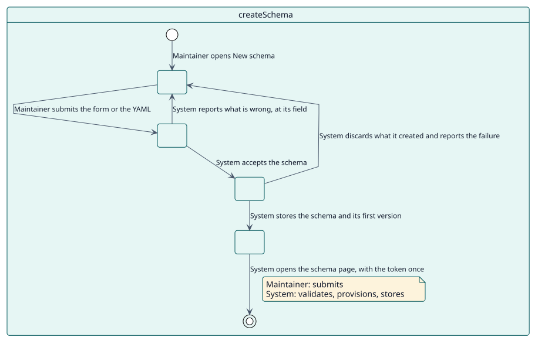
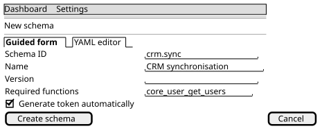

# UC-001 Crear un esquema

| Resumen | Requisitos | Análisis | Diseño | Implementación | Pruebas |
| --- | --- | --- | --- | --- | --- |
| [Casos de uso](../../use-case-overview.svg) | **Requisitos** | [Análisis](../../../analysis/use-cases/createSchema/README.md) | [Diseño](../../../design/use-cases/createSchema/README.md) | [Implementación](../../../implementation/use-cases/createSchema/README.md) | [Pruebas](../../../implementation/use-cases/createSchema/README.md#pruebas) |

## Información del caso de uso

| Campo | Valor |
| --- | --- |
| Actor | Responsable |
| Paquete | Schemas |
| Objetivo | Convertir un esquema YAML en un usuario de servicio, un rol, un servicio externo y un token. |
| Tipo | Primario, esencial |
| Nivel | Objetivo de usuario |
| Requisito | RF-001 |
| Entidades del dominio | Schema, SchemaVersion, ServiceUser, ServiceRole, ExternalService, Token, WebServiceFunction |

## Contexto

Un consumidor del sitio necesita su propia entrada a los servicios web. El responsable lo describe en un esquema y el plugin construye todo lo que necesita, de modo que el consumidor solo alcanza lo que el esquema declara.

## Precondiciones

- El responsable tiene `local/servicemanager:manage`.
- Los servicios web del sitio están activos, para que el servicio pueda responder.

## Postcondiciones

- Éxito: existe un esquema con su primera versión, un usuario de servicio, un rol con las capacidades de sus funciones, un servicio externo con esas funciones y, si se pidió, un token que se muestra una sola vez.
- Fallo: no queda nada de lo que se creó: el usuario, el rol y el servicio se descartan.

## Flujo principal

| Paso | Actor | Sistema |
| --- | --- | --- |
| 1 | Abre **Nuevo esquema** y completa el formulario guiado o escribe el YAML. | Muestra las dos pestañas. |
| 2 | Envía. | Da la versión 1.0.0 a un esquema que no tiene ninguna. |
| 3 |  | Valida el ID, el nombre, las funciones, los plugins y la sección del rol. |
| 4 |  | Crea el usuario de servicio, el rol con sus capacidades y ajustes, el servicio externo con sus funciones y los usuarios autorizados, y el token si se pidió. |
| 5 |  | Guarda el esquema y su primera versión en el historial. |
| 6 |  | Abre la página del esquema y muestra el token una vez, con los avisos, si los hay. |

## Flujos alternativos

| ID | Empieza en el paso | Condición | Comportamiento | Termina |
| --- | --- | --- | --- | --- |
| A1 | 3 | El esquema no es válido: un ID o un nombre repetido, una función crítica que este Moodle no tiene, un rol que no existe. | Muestra cada error en su campo; no se crea nada. | Paso 1 |
| A2 | 4 | Falla la creación de alguna parte. | Descarta lo que se creó y muestra el error. | Paso 1 |
| A3 | 4 | Falta una función que no es crítica, un plugin, una capacidad o un usuario adicional. | Crea el esquema y muestra un aviso. | Paso 5 |

## Reglas de negocio

| ID | Regla |
| --- | --- |
| RN-001 | El ID y el nombre de un esquema son únicos. |
| RN-002 | Una función crítica que falta bloquea la creación; una no crítica solo avisa. |
| RN-003 | Todo lo creado se descarta si alguna parte falla. |

## Especificación

Fuente de verdad del comportamiento: [specification.puml](./specification.puml)

## Prototipos

