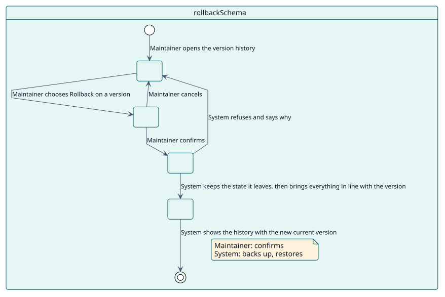
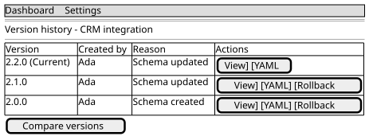

# UC-003 Deshacer hasta una versión

| Resumen | Requisitos | Análisis | Diseño | Implementación | Pruebas |
| --- | --- | --- | --- | --- | --- |
| [Casos de uso](../../use-case-overview.svg) | **Requisitos** | [Análisis](../../../analysis/use-cases/rollbackSchema/README.md) | [Diseño](../../../design/use-cases/rollbackSchema/README.md) | [Implementación](../../../implementation/use-cases/rollbackSchema/README.md) | [Pruebas](../../../implementation/use-cases/rollbackSchema/README.md#pruebas) |

## Información del caso de uso

| Campo | Valor |
| --- | --- |
| Actor | Responsable |
| Paquete | Schemas |
| Objetivo | Devolver un esquema, y lo que creó, a una versión anterior. |
| Tipo | Primario, esencial |
| Nivel | Objetivo de usuario |
| Requisito | RF-003 |
| Entidades del dominio | Schema, SchemaVersion, ServiceRole, ExternalService |

## Contexto

Un cambio resultó equivocado. El responsable elige una versión anterior y el plugin devuelve el esquema y todo lo que creó a ella, sin perder el estado que deja.

## Precondiciones

- El responsable tiene `local/servicemanager:manage`.
- El esquema tiene una versión anterior en su historial.

## Postcondiciones

- Éxito: el esquema, su rol, su servicio y sus funciones coinciden con la versión elegida; el estado que se dejó está en el historial como copia de seguridad.
- Fallo: el esquema queda como estaba.

## Flujo principal

| Paso | Actor | Sistema |
| --- | --- | --- |
| 1 | Abre el **Historial de versiones** de un esquema. | Lista sus versiones, con la actual marcada. |
| 2 | Pulsa **Deshacer hasta aquí** en una versión anterior. | Pide confirmación en una ventana. |
| 3 | Confirma. | Guarda el estado actual en el historial como copia de seguridad cuando no está ya. |
| 4 |  | Restaura el YAML de la versión elegida, el único camino que puede mover la versión hacia atrás, y pone al día el usuario, el rol, el servicio y sus funciones. |
| 5 |  | Muestra el historial con la nueva versión actual, sin añadir una fila por el propio retroceso. |

## Flujos alternativos

| ID | Empieza en el paso | Condición | Comportamiento | Termina |
| --- | --- | --- | --- | --- |
| A1 | 2 | El responsable cancela. | Cierra la ventana y no cambia nada. | Paso 1 |
| A2 | 4 | La versión no pertenece al esquema. | Lo rechaza con un error. | Paso 1 |

## Reglas de negocio

| ID | Regla |
| --- | --- |
| RN-006 | Un retroceso conserva el estado que deja, así que no se pierde nada. |
| RN-007 | Un retroceso es la única forma en que un esquema vuelve a un número de versión más bajo. |

## Especificación

Fuente de verdad del comportamiento: [specification.puml](./specification.puml)

## Prototipos

