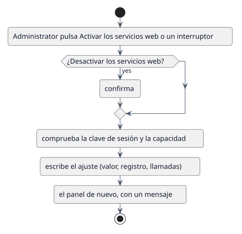
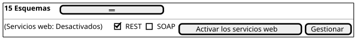

# UC-005 Activar o desactivar los servicios web y sus protocolos

| Vista general | Requisitos | Análisis | Diseño | Implementación | Pruebas |
| --- | --- | --- | --- | --- | --- |
| [Casos de uso](../../../requirements/use-case-overview.svg) | **Requisitos** | [Análisis](../../../analysis/use-cases/turnWebServices/README.md) | [Diseño](../../../design/use-cases/turnWebServices/README.md) | [Implementación](../../../implementation/use-cases/turnWebServices/README.md) | [Pruebas](../../../implementation/use-cases/turnWebServices/README.md#tests) |

## Información del caso de uso

| Campo | Valor |
| --- | --- |
| Actor | Administrator |
| Paquete | Administration |
| Objetivo | Hacer que los servicios web del sitio, y cada protocolo, respondan o dejen de responder, sin abrir la administración de Moodle. |
| Tipo | Primario, esencial |
| Nivel | Objetivo de usuario |
| Requisito | RF-008 |
| Entidades del dominio | WebServiceState |

## Contexto

Un esquema puede ser perfecto y no responder cuando los servicios web del sitio están desactivados, o activados sin ningún protocolo. El resumen del panel lo indica y, a una persona que puede cambiar la configuración del sitio, le permite activarlos o desactivarlos donde ve el problema.

## Precondiciones

- La persona tiene `moodle/site:config` en el sistema.

## Postcondiciones

- Éxito: el ajuste tiene el valor nuevo, el cambio está en el registro de la configuración con su valor anterior y el panel lo indica.
- Fallo: no cambia nada.

## Flujo principal

| Paso | Actor | Sistema |
| --- | --- | --- |
| 1 | Pulsa **Activar los servicios web**, o el interruptor de un protocolo, en el resumen del panel. | Comprueba la clave de sesión y la capacidad. |
| 2 |  | Escribe el ajuste como lo escribe la administración: el valor, el registro de la configuración y las llamadas posteriores del ajuste. |
| 3 |  | Vuelve a abrir el panel con un mensaje que indica qué está activado o desactivado. |

## Flujos alternativos

| ID | Empieza en el paso | Condición | Comportamiento | Termina |
| --- | --- | --- | --- | --- |
| A1 | 1 | La persona pulsa **Desactivar los servicios web**. | Pide confirmación antes, ya que todos los servicios web del sitio dejan de responder. | Paso 2 |
| A2 | 1 | La persona no puede cambiar la configuración del sitio. | Muestra el estado y los interruptores sin permitir cambiarlos. | Fin |
| A3 | 2 | El ajuste ya tiene el valor pedido. | No escribe nada. | Paso 3 |

## Reglas de negocio

| ID | Regla |
| --- | --- |
| RN-010 | Los servicios web y sus protocolos solo los cambia una persona que puede cambiar la configuración del sitio, y cada cambio queda en el registro de la configuración con su valor anterior, lo que lanza el evento `config_log_created`. |

## Especificación

Fuente de verdad del comportamiento: [specification.puml](./specification.puml)

## Bocetos

