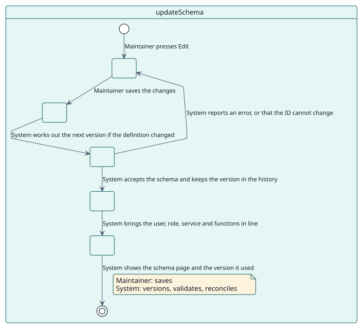
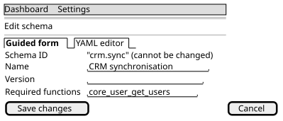

# UC-002 Actualizar un esquema

| Resumen | Requisitos | Análisis | Diseño | Implementación | Pruebas |
| --- | --- | --- | --- | --- | --- |
| [Casos de uso](../../use-case-overview.svg) | **Requisitos** | [Análisis](../../../analysis/use-cases/updateSchema/README.md) | [Diseño](../../../design/use-cases/updateSchema/README.md) | [Implementación](../../../implementation/use-cases/updateSchema/README.md) | [Pruebas](../../../implementation/use-cases/updateSchema/README.md#pruebas) |

## Información del caso de uso

| Campo | Valor |
| --- | --- |
| Actor | Responsable |
| Paquete | Schemas |
| Objetivo | Poner el servicio al día con un esquema cambiado y conservar su versión. |
| Tipo | Primario, esencial |
| Nivel | Objetivo de usuario |
| Requisito | RF-002 |
| Entidades del dominio | Schema, SchemaVersion, ServiceRole, ExternalService, WebServiceFunction, RoleSettings |

## Contexto

Un consumidor necesita más, o menos, de lo que dice su esquema. El responsable cambia el esquema y el plugin pone al día el rol, el servicio y sus funciones, conservando cada versión.

## Precondiciones

- El responsable tiene `local/servicemanager:manage`.
- El esquema existe.

## Postcondiciones

- Éxito: el usuario, el rol, el servicio y sus funciones coinciden con el esquema; la nueva versión está en el historial; la página del esquema dice qué versión se usó.
- Fallo: el esquema queda como estaba.

## Flujo principal

| Paso | Actor | Sistema |
| --- | --- | --- |
| 1 | Pulsa **Editar** en un esquema. | Abre el formulario con el esquema relleno. |
| 2 | Cambia lo necesario y guarda. | Calcula la versión siguiente cuando la definición cambió y la versión se dejó vacía, repetida o más baja. |
| 3 |  | Valida el esquema, excluyéndolo a él mismo, y comprueba que su ID es el mismo. |
| 4 |  | Guarda la versión en el historial. |
| 5 |  | Pone al día el usuario, el rol, sus capacidades y ajustes, el servicio y sus funciones: lo añadido se crea y lo quitado se retira. |
| 6 |  | Muestra la página del esquema y la versión que usó. |

## Flujos alternativos

| ID | Empieza en el paso | Condición | Comportamiento | Termina |
| --- | --- | --- | --- | --- |
| A1 | 3 | Se cambió el ID. | Lo rechaza: un ID no cambia nunca. | Paso 2 |
| A2 | 3 | El esquema no es válido. | Muestra cada error en su campo. | Paso 2 |
| A3 | 2 | Solo cambió el nombre, el responsable o la descripción. | Conserva la versión. | Paso 5 |

## Reglas de negocio

| ID | Regla |
| --- | --- |
| RN-004 | Un cambio de la definición sube la versión por sí mismo cuando no es más alta que las que ha tenido el esquema. |
| RN-005 | El ID de un esquema no cambia nunca. |

## Especificación

Fuente de verdad del comportamiento: [specification.puml](./specification.puml)

## Prototipos

